> [!note] 一句话总结
> Agent 的演进有**两条交织的线**：
> 1. **模式（行为）线**：让大模型「学会动手」→「学会思考」→「学会分工」，即 **Tool Use → ReAct → Reflection → Planning → Multi-Agent**；
> 2. **工程（形态）线**：控制权从「确定性静态 Workflow」→「动态黑盒 Loop（ReAct）」→「Workflow 骨架 + ReAct 血肉的 **Graph**」，再到「**LLM 自主生成的动态 Graph**」。
>
> 本笔记把这两条线整合成一份系统视图：每个模式配图、每条工程形态配图，并落到 LangGraph 的具体原语与代码。

---

## 一、五种 Agent 模式演进（从「实习生」到「CEO」）

> 演进脉络：Level 1-2 解决「**怎么做**」（与环境交互的手脚）→ Level 3 解决「**做错了怎么改**」（大脑修正）→ Level 4 解决「**先做什么后做什么**」（大脑预演）→ Level 5 解决「**一个人忙不过来**」（组织架构）。

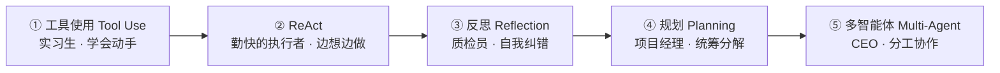

### ① 工具使用模式（Tool Use）——「实习生」

- **核心逻辑**：大模型不再只靠「记忆力」回答，而是主动调用外部 API（搜索引擎、计算器、数据库）获取实时信息或执行操作。
- **关键突破**：解决大模型「**幻觉**」和「**时效性**」问题，模型从「思考者」变为「执行者」。
- **技术要点**：**Function Calling**——模型需要决策「何时用工具」以及「传入什么参数」。
- **适用场景**：查询天气、预订酒店、执行 SQL、发送邮件。

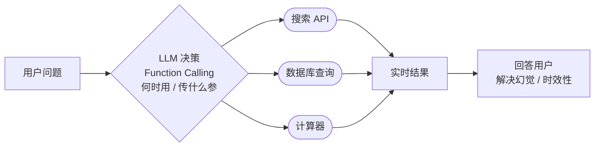

### ② ReAct 模式（ReAct Pattern）——「勤快的执行者」

- **核心逻辑**：将**推理（Reasoning）**与**行动（Acting）**交错进行，即 `思考 → 行动 → 观察结果 → 再思考 → 再行动`（Thought-Action-Observation 循环）。
- **关键突破**：相比工具使用的单次调用，ReAct 支持**多轮迭代**，执行中根据中间反馈**动态调整策略**。
- **技术要点**：提示词工程让模型输出结构化的 Thought/Action/Observation，或用 Agent 框架（如 LangChain）强制实现循环。
- **适用场景**：需要多步操作的复杂检索。

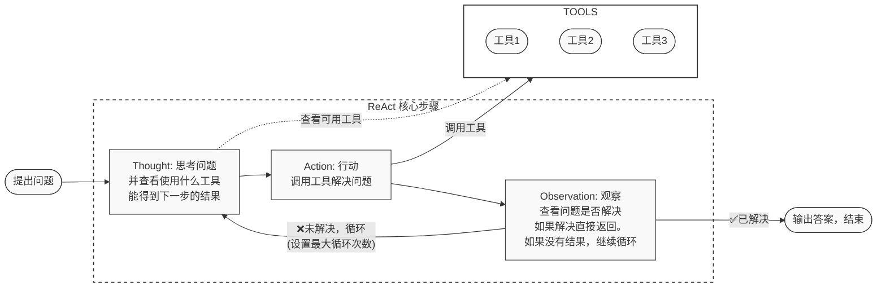

> [!tip] ReAct 两种实现路径
> - **纯提示词**：让模型每步输出 `Thought/Action/Observation` 三段结构化文本，人为解析并拼接循环（表驱动）。
> - **框架强制**：LangChain `AgentExecutor` / LangGraph 将 ReAct 实现为 `agent_node ↔ tools_node` 的循环节点。

### ③ 反思模式（Reflection Pattern）——「质检员」

- **核心逻辑**：让 Agent 对自身输出进行**自我批评（Self-Critique）**与**自我修正**。生成初稿后扮演「评审」指出缺陷，再根据反馈重写。
- **关键突破**：引入「**双角色**」（执行者 + 评判者）或「**双轮次**」（生成 + 反思），极大提升输出质量，不依赖外部人类反馈。
- **技术要点**：多轮同模型推理（不同 System Prompt），或两个模型互相对话（Generative + Discriminative）。
- **适用场景**：代码 Debug、长文润色、数学题验算、高质量翻译。

**形态一：基础反思（带人类反馈的闭环）** —— 人类是唯一评判者，成本高但质量极高。

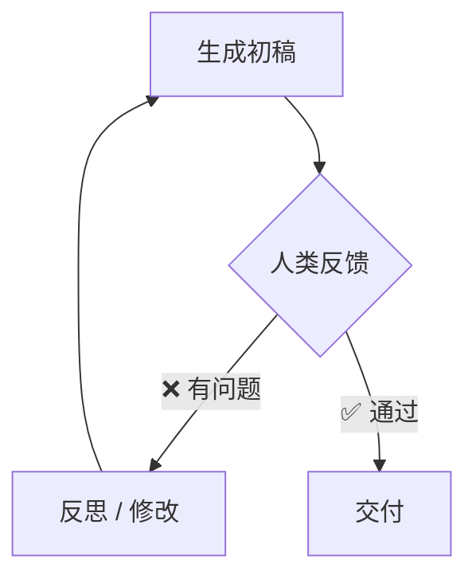

**形态二：高级反思（零外部依赖的内部自省）** —— 模型自身同时扮演执行者与评判者。

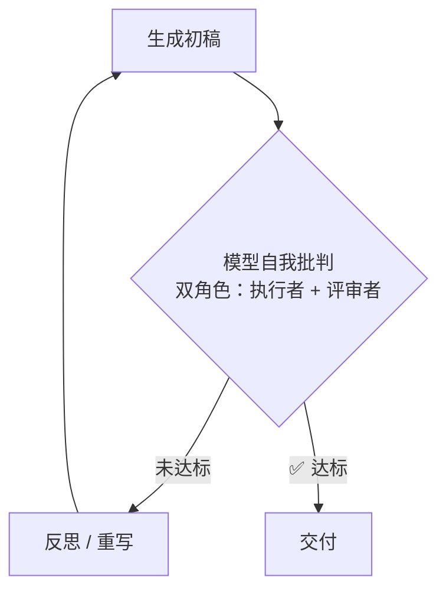

> [!note] 反思模式的变迁（不是矛盾）
> 两种描述都对，代表不同成熟度：
>
> | 维度 | 形态一：基础反思（带人类反馈） | 形态二：高级反思（自我批判） |
> | --- | --- | --- |
> | **评判者** | 人类（外部） | 模型自身（内部） |
> | **核心机制** | 生成 → 人类批评 → 修改 | 生成 → 自我批评 → 修改 |
> | **优势** | 质量极高，融合专业判断 | 全自动化、低成本、可规模化 |
> | **场景** | 专业领域、正确性要求极高 | 代码优化、文案润色、通用问答 |
> | **阶段** | 早期、基础 | 演进、高级 |
>
> 两者常被组合使用：先用「高级反思」多轮内省，最后送入「基础反思」让人工做最终确认。

### ④ 规划模式（Planning Pattern）——「项目经理」

- **核心逻辑**：面对极复杂任务（如「写一个电商网站」），Agent 先**拆解（Decomposition）**大目标为子任务（Sub-goals），规划执行顺序（含依赖关系），再按图执行。
- **关键突破**：解决 ReAct 在长序列任务中「**迷失目标**」或「**陷入死循环**」的问题。代表：**Plan-and-Solve**、**LLMCompiler**。
- **技术要点**：**Planner**（生成 DAG 执行计划）+ **Executor**（跑具体任务）+ **Verifier**（核对每步是否达成）。
- **适用场景**：自动化市场调研、竞品分析、测试用例编写。
- **推广到 "Plan & Execute"**：先全局规划（宏观大纲），再进入执行；**执行阶段不一定是纯顺序，某一步可以并发执行**。

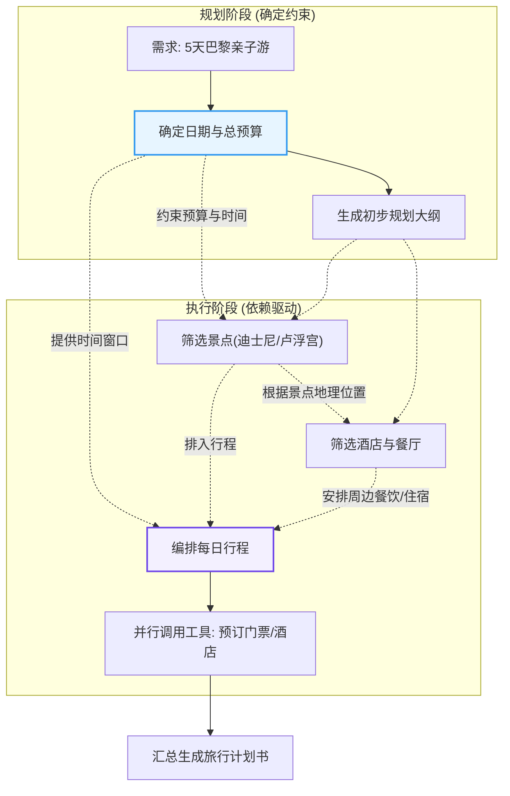

> [!tip] 规划 + 执行 = Power
> 规划模式的主干（Workflow）通常配合工具使用；它解决的是「先做什么、后做什么、什么能并行」——也正是 Graph 硬骨架的来源。

### ⑤ 多智能体模式（Multi-Agent Pattern）——「CEO」

- **核心逻辑**：多个独立 Agent（不同角色、提示词、甚至不同底模）组成**协作网络**，通过「辩论（Debate）/ 委派（Delegate）/ 投票（Vote）」完成单一 Agent 无法胜任的跨领域任务。
- **关键突破**：**分工与协作** + 群体智能（Swarm Intelligence）纠正单个 Agent 的偏见。代表：**AutoGen、MetaGPT、CrewAI**。
- **技术要点**：角色定义（Role-based）、通信机制（Message Passing）、冲突解决（仲裁者 Agent）、任务分配（Scheduler）。
- **适用场景**：软件全流程开发、复杂商业决策模拟。

**形态 A：瀑布流并行的多源收集→整合→审核**（如财报分析：多渠道采集 → 清洗 → 分析 → 独立审核）

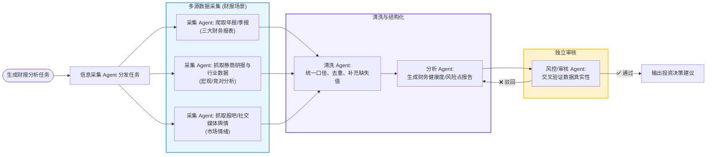

**形态 B：树状管理层的软件开发流程**（强调先后依赖：Tech Lead 先架构 → SDE 写代码 → DevOps 后介入）

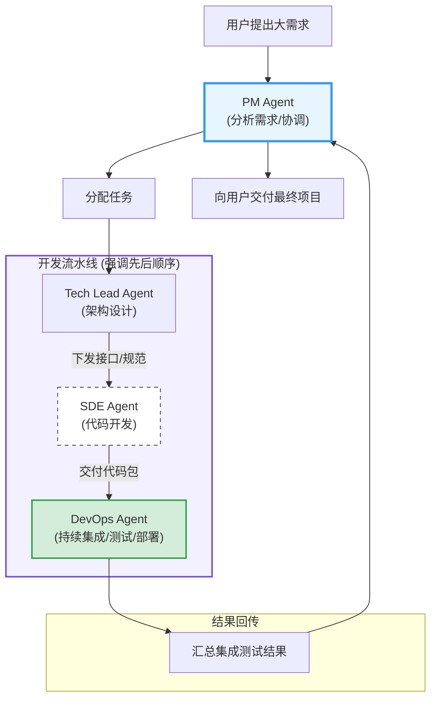

### 演进总结与进阶建议

| 阶段 | 类比 | 解决的问题 | 工程形态 |
| --- | --- | --- | --- |
| Level 1-2（Tool Use / ReAct） | 手脚 | 怎么做（与环境交互） | Harness / Loop |
| Level 3（Reflection） | 大脑修正 | 做错了怎么改（自我进化） | Loop（双轮次） |
| Level 4（Planning） | 大脑预演 | 先做什么后做什么（全局统筹） | Graph 硬骨架 |
| Level 5（Multi-Agent） | 组织架构 | 一个人忙不过来（群体智能） | Graph 动态子图 |

> [!warning] 并不是越高级越好
> 多 Agent 模式带来极高的 **Token 消耗和延迟**，且容易「碎嘴」跑偏。成熟方案通常是 **「规划模式 + 工具使用」作主流程**，配合**局部「反思模式」做质量兜底**，只有领域差异极大时才启用多智能体。

---

## 二、工程形态演进：Workflow → ReAct(Loop) → Graph

这是同一能力的**工程化形态**演进，本质是「**确定性**」与「**智能性**」如何走向融合。

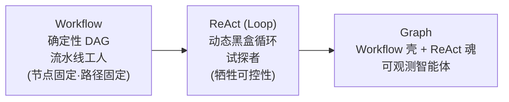

### 1. 早期 Workflow——「流水线工人」

- **形态**：纯代码硬编码（`if-else` / `switch-case`），或低代码工具（Zapier、Dify）。
- **核心特征**：节点固定、路径固定，无歧义。
- **致命缺陷**：一旦中间需要「阅读理解」或「模糊决策」，硬编码写不下去。
- **评价**：本质就是静态的、无智能的图（Graph）。

### 2. ReAct（Loop）——「黑盒试探者」

- **形态**：`while True: 思考 -> 行动 -> 观察`。
- **核心特征**：用**无限循环**替代固定边，Agent 自己通过 Token 生成决定「下一步去哪」，开发者无法预判路径。
- **致命缺陷**：有了智能，但**牺牲了可控性**——无法中途强制走某分支，步数多了还会在循环里迷路（忘记初始目标）。
- **主流对 Loop 的补充视角**：Loop 不仅是思考循环，更指**单线程、同步阻塞、无暂停机制的执行器**。它无法中途**挂起（Suspend）**等人审批，也无法在 A 任务等 API 响应时切去执行 B 任务。

### 3. Graph（Workflow + ReAct）——「可观测的智能体」

> 这是新一代框架（**LangGraph、Mastra、Rig**）正在实现的终极形态：**用 Workflow 的壳，包裹 ReAct 的魂**。

| 维度 | 纯 Workflow（旧图） | 纯 ReAct（旧循环） | Graph（新融合体） |
| --- | --- | --- | --- |
| **节点（Node）** | 固定的 API 调用或代码函数 | 每次 Thought/Action 都是动态节点 | 节点可以是一个完整的 ReAct Loop（如「检索节点」内部自己循环查三次库） |
| **边（Edge）** | 硬编码 `goto`（无条件） | 隐式边（模型输出什么调什么工具） | 显式条件边（Conditional Edge）+ 动态边，主干由开发者画，分岔口由 Agent 路由 |
| **状态（State）** | 局部变量，用完即弃 | 全部塞进 Context Window，越长越笨 | 全局状态字典（State Schema），共享读写，只留关键摘要，支持持久化存档 |

**Graph 底层两件核心创新**（LangGraph 作者 Harrison Chase 思路）：

- **状态持久化（Persistence）**：每执行一个节点，完整 State 自动存入数据库（**Checkpointer**）。
- **时间旅行（Time Travel）**：因为有「存档」，Graph 允许：
  - **暂停（Breakpoint）**：执行到某节点前自动停下，等人输入后**恢复（Resume）**；
  - **分叉（Fork）**：从历史存档点拉新分支，尝试不同方案。

> [!note] 一句话
> 从 Loop 到 Graph，不只是实现「更复杂的跳转」，更是实现「**有状态、可中断、可恢复的企业级长时任务（Long-running Task）**」。

### 典型场景：自动客服退款（硬约束）

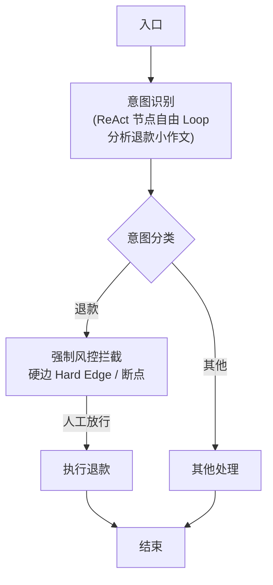

- **纯 ReAct（Loop）**：Agent 可能先查天气再编首诗退钱，你**无法强制它必须先过风控**。
- **Workflow + ReAct（Graph）**：用 Workflow 画「硬骨架」，强制风控是绕不过去的硬边；但在「意图识别」节点内部用 ReAct 自由 Loop。
- **子图（Sub-graph）**：LangGraph 支持把一个完整 ReAct Loop 封装成节点塞进大 Workflow—— **ReAct 是 Graph 的「插件」，Workflow 是 Graph 的「骨架」**。

### 易踩误区

> 很多人以为：「我用 `AgentExecutor` + `max_iterations=10` 就是 Loop；换 `langgraph` 画几个节点就是 Graph。」
>
> 严谨定义：如果用 LangGraph 把 ReAct 的 `while` 拆成 `agent_node` ↔ `tools_node` 互相跳转，**仍是「Graph 的壳，跑 Loop 的魂」**。真正的 Graph 思维是把业务拆成 **DAG 或带条件边的有限状态机**，其中循环只是众多边的一种特殊情况。

---

## 三、关注点迁移：Harness 工程 → Loop 工程 → Graph 工程

对应**抽象层次的不断抬升**（Andrej Karpathy 的「LLM OS」、DSPy 的编译器思路）。

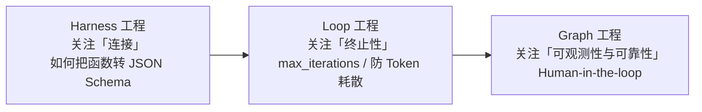

| 阶段 | 主流关注的核心问题 | 工程落地的「代码形态」 |
| --- | --- | --- |
| **Harness（工具调用）** | 「连接」：怎么把 Python 函数转 JSON Schema、怎么拦截输出 | 写大量 `if "tool_call" in response:` |
| **Loop（ReAct）** | 「终止性」：怎么设 `max_iterations`、防 Token 无限消耗 | 写 `while max_steps > 0`，手动拼接消息列表 |
| **Graph（多智能体/规划）** | 「可观测性与可靠性」：让每步决策透明，实现 Human-in-the-loop | 声明式定义节点，框架负责调度与状态回写 |

**结论**：你说的「Graph 代表多智能体分工、条件分支、并行」是**业务表现（上半身）**；主流正在猛攻的是 Graph 的**下半身——持久化与可恢复性**。

---

## 四、Graph 的下一站：动态 Graph（LLM 自主规划）

> Workflow 这部分能否**也让 LLM 根据任务动态生成**，而非人工预先硬编码？——答案是可以，而且是业界前沿正在努力的方向。

- 标志：Agent 从「**人类画图，LLM 走路**」迈向「**LLM 既是设计师，又是执行者**」。
- 演进：**Graph（Workflow + ReAct）** 的下一站 = **Dynamic Graph（LLM-Generated Workflow + ReAct）**。

### 两条技术路径

**路径 1：LLM 显式生成「执行图」（LLMCompiler）**
LLM 充当「编译器」，把用户问题直接编译成由工具调用构成的 **DAG**。节点是工具调用，边用 `$1`、`$2` 占位符传递数据依赖，支持**并行执行**。规划器一次性生成全局调度图，执行中无需反复决策。

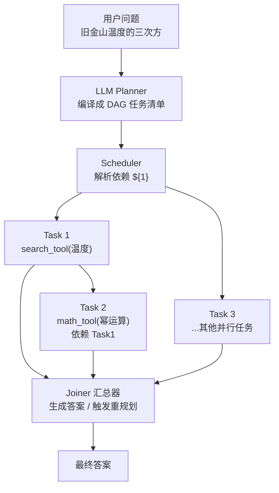

**路径 2：LLM 隐式规划与动态路由（Plan-and-Execute 变体）**
规划器先生成高层「任务蓝图」，执行器每走一步都**重新评估（Re-evaluate）**，判断继续原计划还是调整。极致形态如 **GraphPlanner**——不仅决定调用哪个模型，还能动态决定每个模型扮演的角色（规划者/执行者/总结者），为每个任务「即时编织」一个多智能体协作 Graph。前沿 **GraphPlan** 甚至能做到**自适应简约性（Adaptive Parsimony）**：简单任务只输出线性链条，复杂任务才加诊断、重试等分支。

### LangGraph 提供的「乐高积木」（没有一键 API，但有原语）

| 需求 | 原语 | 说明 |
| --- | --- | --- |
| 动态决定**去向（路由）** | `add_conditional_edges` | LLM 执行路由函数，读 State 返回下一个节点名 |
| 动态**跳转 + 更新状态** | `Command` | 节点返回 `Command` 同时「更新状态」+「跳到指定节点」 |
| 动态决定**扇出数（并行）** | `Send` | 上游节点返回多个 `Send`，各指向目标节点 + 独立 State，真正并行执行 |

### 代码实现一：Send API 动态并行扇出（Fan-out）

典型场景：给主题列表，同时独立分析每个主题，最后合并成报告。

```python
import operator
from typing import Annotated, TypedDict, List
from langgraph.graph import StateGraph, START, END
from langgraph.types import Send
from langchain_openai import ChatOpenAI

class OverallState(TypedDict):
    topics: List[str]
    # 所有 worker 返回的 analyses 自动合并成一个大列表
    analyses: Annotated[list[str], operator.add]
    final_report: str

class WorkerState(TypedDict):
    topic: str

llm = ChatOpenAI(model="gpt-4o-mini")

# 返回多个 Send 触发并行
def fan_out_to_workers(state: OverallState) -> List[Send]:
    return [Send("analyze", {"topic": topic}) for topic in state["topics"]]

def analyze_node(state: WorkerState) -> dict:
    response = llm.invoke(f"请用一句话分析以下主题的现状和前景：{state['topic']}")
    return {"analyses": [f"**{state['topic']}**: {response.content}"]}

def synthesize_node(state: OverallState) -> dict:
    combined = "\n\n".join(state["analyses"])
    response = llm.invoke(f"基于以下分析，生成一份简洁的总结报告：\n{combined}")
    return {"final_report": response.content}

builder = StateGraph(OverallState)
builder.add_node("analyze", analyze_node)
builder.add_node("synthesize", synthesize_node)
builder.add_conditional_edges(START, fan_out_to_workers, ["analyze"])
builder.add_edge("analyze", "synthesize")  # LangGraph 自动处理 fan-in
builder.add_edge("synthesize", END)
graph = builder.compile()

result = graph.invoke({"topics": ["量子计算", "可再生能源", "太空探索"]})
print(result["final_report"])
```

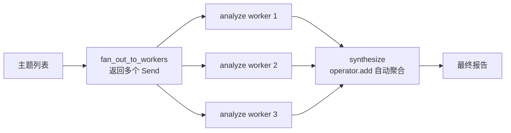

**关键点**：
- `Send("analyze", {"topic": topic})`：启动一个 `analyze` 实例并传入独立子状态。
- `Annotated[list[str], operator.add]`：所有 worker 返回的 `analyses` 自动合并，无需手动拼接。
- 所有 Send 的 worker **真正并行**执行。

### 代码实现二：LLMCompiler（LLM 自主规划 DAG）

三个组件：**Planner**（流式生成任务，用 `${1}` 表达依赖）→ **Scheduler**（解析依赖，就绪即提交线程池并行）→ **Joiner**（汇总结果，成功即出答案，失败触发重规划）。

```python
import re
from concurrent.futures import ThreadPoolExecutor, wait
from typing import List, Dict, Any, Optional
from langgraph.graph import StateGraph, START, END
from langgraph.types import Send
from langchain_openai import ChatOpenAI
from langchain_core.tools import BaseTool
from langchain_core.messages import HumanMessage, AIMessage, ToolMessage

class Task(TypedDict):
    idx: int
    tool: str          # 工具名称
    args: dict
    dependencies: List[int]  # 依赖的任务 idx 列表
    thought: str

PLANNER_PROMPT = """
你是一个任务规划器。请将用户问题分解为一系列工具调用任务。
输出格式严格遵循以下示例：
1. search_tool(query="当前的温度")
2. math_tool(problem="x ** 3", context=["$1"])

其中 $1 表示依赖第1个任务的输出结果。
如果任务可以并行执行，请不要在它们之间添加依赖关系。
最后必须包含一个 join() 任务表示计划结束。

用户问题：{question}
"""

def create_planner(llm, tools: List[BaseTool]):
    tool_descriptions = "\n".join([f"- {t.name}: {t.description}" for t in tools])

    def planner_node(state: dict) -> dict:
        messages = state.get("messages", [])
        question = messages[-1].content if messages else ""
        prompt = PLANNER_PROMPT.format(question=question, tool_descriptions=tool_descriptions)
        response = llm.invoke(prompt)
        tasks = parse_tasks(response.content)   # 思路示意，含完整解析逻辑
        return {"tasks": tasks, "observations": {}, "completed": set()}

    return planner_node

def schedule_tasks(state: dict) -> List[Send]:
    """依赖就绪的任务立即 Send 触发并行执行。"""
    tasks = state.get("tasks", [])
    observations = state.get("observations", {})
    completed = state.get("completed", set())
    executable = []
    for task in tasks:
        idx = task["idx"]
        if idx in completed:
            continue
        deps_done = all(dep in completed for dep in task.get("dependencies", []))
        if deps_done:
            executable.append(Send("execute_task", {"task": task, "observations": observations}))
    return executable if executable else [Send("finalize", {})]

def execute_task_node(state: dict) -> dict:
    """由 Send 调度，每个任务并行执行。"""
    task = state["task"]
    observations = state.get("observations", {})
    resolved_args = resolve_args(task["args"], observations)  # 替换 ${1} 占位符
    tool = get_tool_by_name(task["tool"])
    result = tool.invoke(resolved_args)
    return {"observations": {task["idx"]: result}, "completed": {task["idx"]}}

def finalize_node(state: dict) -> dict:
    observations = state.get("observations", {})
    sorted_results = sorted(observations.items())
    answer = "\n".join([f"步骤{idx}: {result}" for idx, result in sorted_results])
    return {"messages": [AIMessage(content=answer)]}

builder = StateGraph(dict)
builder.add_node("planner", create_planner(llm, tools))
builder.add_node("execute_task", execute_task_node)
builder.add_node("finalize", finalize_node)
builder.add_edge(START, "planner")
builder.add_conditional_edges("planner", schedule_tasks)  # planner 输出 → 动态扇出
builder.add_edge("execute_task", "finalize")             # 并行完成后汇聚
builder.add_edge("finalize", END)
graph = builder.compile()
```

**LLMCompiler 核心优势**：
1. **并行执行**：无依赖关系的任务自动并行（如查温度与幂运算，若幂运算依赖温度则等待）。
2. **减少 LLM 调用**：ReAct 每步调一次 LLM；LLMCompiler 只调一次 Planner + 一次 Joiner。
3. **依赖解析**：`${1}` 占位符让 LLM 清晰表达任务间数据流依赖。

### 权衡与「手动编排 vs 自动规划」

- **首响应延迟（Time-to-First-Action）**：必须先等 LLM 生成完整计划才开始执行第一步；ReAct 边想边做，体验更快。
- **高昂初始 Token**：生成复杂 DAG 计划本身消耗大量 Token，有时比 ReAct 完成简单任务还贵。
- **LangGraph 现状 = 手动编排**：开发者是「架构师」，用 `Send`/`Command` 构建 LLM 驱动的决策路由器，LLM 在候选路径中做选择。
- **你的终极设想 = 自动规划**：LLM 自己当「架构师」，从零为任务即时设计完整 Graph。目前仍需开发者用原语 + LLMCompiler 思路去编码实现——「引擎和变速箱齐全，但没有一键自动驾驶」。

### Send vs LLMCompiler 对比

| 特性 | Send API (Fan-out) | LLMCompiler |
| --- | --- | --- |
| **控制者** | 开发者定义的逻辑函数 | LLM Planner 动态生成 |
| **分支数** | 由 state 中列表长度决定 | 由 LLM 根据任务复杂度决定 |
| **依赖管理** | 简单汇聚（所有 worker → 同一下游） | 复杂 DAG 依赖（`${1}` 占位符） |
| **并行粒度** | worker 级别并行 | 任务级别并行，可混合串行/并行 |
| **适用场景** | Map-Reduce（固定流程 + 动态数据） | 开放域任务（流程和分支都需 LLM 自主规划） |

---

## 五、反思模式与 HITL（Human-in-the-Loop）

### 反思 = HITL 的业务形态，HITL = 反思的工程底盘

同一件事的两种视角：

- **算法视角**：带人类反馈的反思模式（AI 生成 → 人类反馈 → AI 修正）。
- **系统架构视角**：标准 HITL 工作流（运行到关键节点 → **挂起等待人工输入** → 恢复执行）。

**三层概念统一**：

1. **业务层面**：AI 初筛 → 专家反馈 → AI 修正（反思模式）；
2. **工程层面**：运行 → 中断 → 等待 → 恢复（HITL）；
3. **框架层面**：LangGraph 的 `interrupt` + `checkpointer` + `resume` 原语。

> 大脑路径：**「我需要反思模式实现人机协作 → 因此在 Graph 工程关键节点用 HITL 挂起 → 等待外部专家反馈 → resume」**。

### LangGraph 中 HITL 如何实现（以支付审核为例）

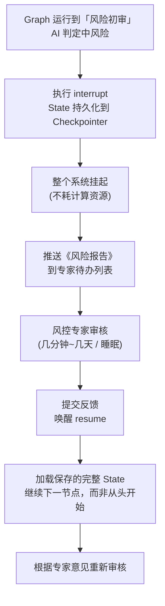

### HITL 的两个层次

| 层次 | 实现方式 | 场景 | 特点 |
| --- | --- | --- | --- |
| **同步 HITL（简单版）** | 脚本里加 `input()` 等用户终端输入 | 本地调试、Demo | 简单但阻塞主线程，用户不输入就卡死，无法上生产 |
| **异步 HITL（生产版）** | LangGraph `checkpointer` + `interrupt`，状态持久化到数据库 | 支付审核、工单审批、医疗影像复核等**长时任务** | 支持挂起/恢复/从历史分支重试，Agent 与人类工作流彻底解耦 |

### 成熟业务中的反思：分层校验 + 状态机 + 补偿

> ❗ 关键认知：成熟业务里「反思」**不是简单一张图里的一个判断框**，而是**分层、分步骤、异步校验 + 重试（Retry）+ 补偿（Compensation）**。

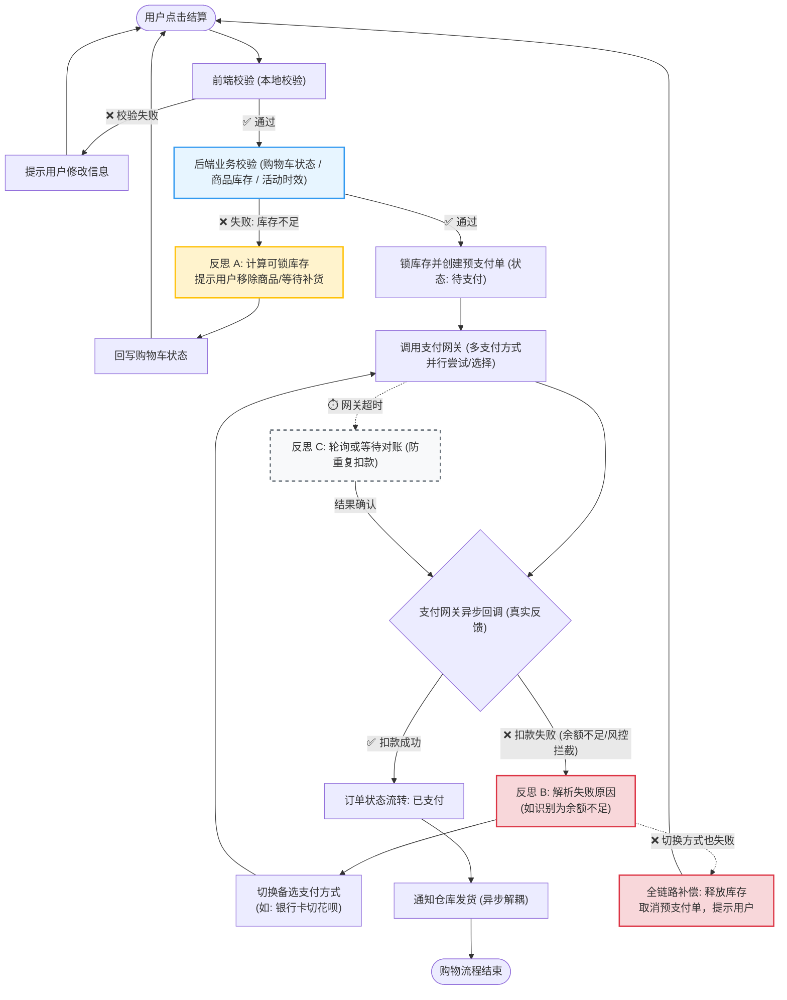

**成熟反思的 4 个原则**：
1. **分层校验**：前置校验（客户端/网关）+ 业务校验（购物车/库存/支付规则）+ 风控校验（反欺诈/黑名单）。
2. **状态机驱动**：支付经历 `待支付→支付中→扣款成功/失败`；反思不是无脑「失败重来」，而是分析**失败原因**（余额不足→降级支付方式；库存不足→提示移除商品）。
3. **异步独立重试**：支付超时（前端无响应）但后端其实扣款成功时，反思是在后台**对账（Reconciliation）**，而非让用户再付一次。
4. **补偿兜底**：反思和重试都失败时，必须有**补偿机制**（释放库存、关闭订单）保证最终一致性。

### 硬逻辑 vs 软逻辑：什么时候才需要反思 Agent？

| 流程类型 | 特征 | 用什么 |
| --- | --- | --- |
| **硬逻辑**（如余额不足→重试→失败→报错） | 确定性、毫秒级性能、强一致性 | **传统 if-else / 状态机**——更成熟、更快更稳 |
| **软逻辑**（如语气是否生硬？代码有无并发风险？计划还有哪些隐含成本） | 开放域、自然语言语义、需动态决策 | **反思 Agent / LLM** |

> **成熟架构方案**：**「硬逻辑走传统 Workflow（状态机引擎），软逻辑（异常解释、风控语义识别、内容质量评估）外挂一个反思 Agent 做旁路干预」**。反思 Agent 放**旁路（Sidecar）或异常拦截层（Guardrail）**，绝不放主交易链路。

适合反思 Agent 的支付场景：**风控反欺诈**（综合历史行为/IP/地址语义/改密记录 →「可能盗号，暂缓支付」）、**智能客服补救**（查日志发现钱已扣只欠回调 →「您别急着再付，正在为您冲正」）。

### 软逻辑反思实战：支付超时的三种真相

> 相同表象（支付超时），背后三种截然不同的真相，只有 Agent 能跨系统找线索 + 多维因果推理。

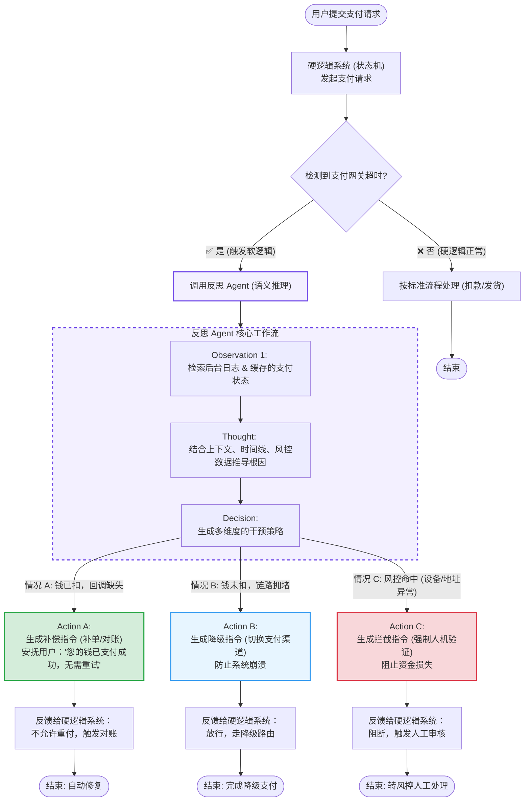

**为什么这是「软逻辑反思」**：
1. 硬编码 if-else **无法分辨同一异常码背后的三种真相**，只有 Agent 能跨系统找线索 + 多维因果推理；
2. 反思 Agent 返回的不是 `true/false`，而是**带自然语言语义的 Action**（安抚、切换、验证），这些是传统系统没预设过的规则；
3. **软硬逻辑解耦**：硬逻辑负责快速稳定与原子性操作，软逻辑负责解释异常并给策略，把指令交还硬逻辑执行。

> 该旁路决策模型不止用于支付——**API 网关故障诊断、客服工单自动分类、舆情监控预警**等一切「处理未知异常 + 综合评判复杂语义 + 动态制定救火策略」的场景都可套用。

---

## 相关笔记

- [[AI大模型/Agent/五种 Agent 模式详解|五种 Agent 模式详解]] —— 五种模式的另一种横向讲解视角
- [[AI大模型/Agent/在Agent中落地ReAct模式（Reasoning + Acting）|在Agent中落地ReAct模式（Reasoning + Acting）]] —— ReAct 闭环 / 状态机落地细节
- [[AI大模型/Agent/HITL人工介入与决策发布|HITL 人工介入与决策发布（6.9-6.10）]] —— HITL 工程落地与决策发布机制
- [[AI大模型/Agent/多Agent编排-LangGraph原生Supervisor与Swarm实现|多Agent编排-LangGraph原生Supervisor与Swarm实现]] —— LangGraph 的 Shared 实现侧（Command / 子图 / Supervisor）
- [[AI大模型/Agent/生产级Agent工程架构蓝图-从Demo到千万级并发|生产级Agent工程架构蓝图（从Demo到千万级并发）]] —— 六层架构 / 状态机闭环 / 高并发
- [[AI大模型/Agent/Agent主流架构对比与选型|Agent主流架构对比与选型]] —— 7 种主流架构演进线 + 选型建议

## 配图技巧附录：Mermaid 排版要点（ReAct 图怎么画）

> 源自《DeepSeek-ReAct流程图Mermaid绘制》的排布经验，画 Agent 结构图时常踩的坑：
>
> 1. **绝对竖直对齐**：「提出问题 / Thought / Action / Observation」要严格中轴对称 => 用**隐形骨架** `Start ~~~ Thought ~~~ Action ~~~ Observation` 强制定位；避免把节点塞进 `subgraph`（Mermaid 会对 subgraph 计算内边距导致偏移）。
> 2. **强制右侧工具框**：用 `Tools ~~~ RightAnchor` 等隐形连线在右侧建立「垂直力场」，锁死 TOOLS 位置，防止其随机漂移到左侧。
> 3. **End 节点分支**：`Observation` 的「✅已解决」直连 End；「❌未解决」沿左侧长线回环到 Thought，并标注最大循环次数。
> 4. **样式**：虚线框（`stroke-dasharray:5 5`）表示「核心步骤容器」，实线框表示「工具」，条件连线用红/灰区分（未解决=红，查看=灰），`classDef` 统一定义便于复用。