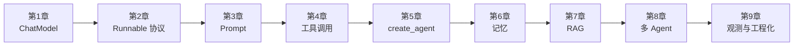
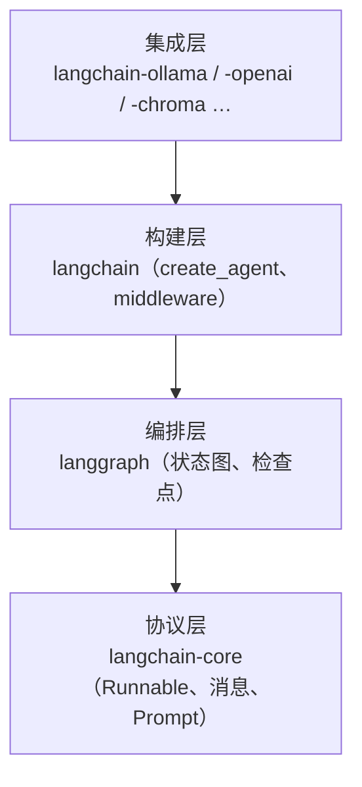
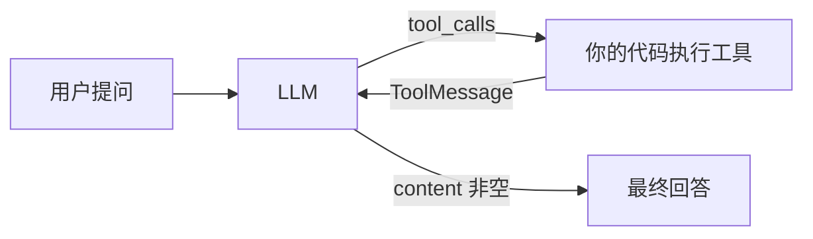
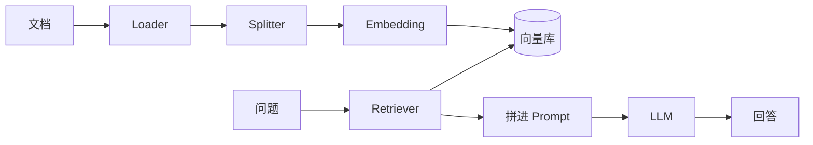

> [!abstract] 这份讲义怎么用
> - **课前**：装好 Python 3.10+ 与 Ollama，拉两个模型（见 §1.3）。课上不花时间配环境。
> - **课中**：每章 = 学习目标 → 一个核心概念 → 一段精简代码 → 小结 → 练习。代码只保留关键 3-8 行，完整版在 [[AI大模型/LangChain/LangChain1.0-RAG+Agent综合示例|LangChain 1.0 RAG+Agent 综合示例]]。
> - **课后**：做「常见误区自查」和「课后项目」，用自测题验收。
> - **不要背 API**。这门课真正要带走的是三个模型：**Runnable 协议、工具调用循环、记忆分层**。

> [!info] 和《LangChain 1.0 迁移总纲》的分工
> 总纲是**给迁移者**的：逐组件对照旧写法 → 新写法。
> 本讲义是**给初学者**的：从第一性原理讲「为什么这样设计」。两篇配合看效果最好——先读讲义建立心智模型，遇到旧代码再查总纲。

---

## 课程地图

| 课时 | 章节 | 回答的问题 | 学完能做到 |
|------|------|-----------|-----------|
| 第 1 课时 | 第 1-3 章 | 模型怎么调？LangChain 凭什么统一？提示词怎么写？ | 写出第一条可运行的 LCEL 链 |
| 第 2 课时 | 第 4-6 章 | 模型怎么用工具？Agent 到底循环什么？记忆为什么分两层？ | 构建带工具和记忆的 Agent |
| 第 3 课时 | 第 7-9 章 | 怎么让模型读自己的文档？多个 Agent 怎么协作？怎么观察？ | 完成一个本地知识库问答 Agent |



---

## 第 1 章 认识 LangChain 1.0

### 学习目标

- 说清 LangChain 解决的是**编排**问题，而不是「让模型变聪明」
- 分清 1.0 的四个层次，知道 `import` 该从哪来
- 跑通第一条模型调用，理解 `AIMessage` 与 `.content`

### 1.1 它到底解决什么问题

大模型 API 本身很简单：发一段文本，收一段文本。真实应用却要处理一堆麻烦事：

| 麻烦 | LangChain 的答案 |
|------|-----------------|
| 各家 API 参数、返回格式不一样 | 统一抽象（`ChatModel`） |
| 多步骤流程要手工拼 | `Runnable` 组合（`\|` 管道） |
| 模型要调用外部函数 | 工具 + 结构化 `tool_calls` |
| 对话要记住上文 | `checkpointer` |
| 文档要检索 | Loader / Splitter / VectorStore / Retriever |

一句话：**LangChain 是「模型与外部世界之间」的胶水层。** 胶水层不出彩，但缺了它，每个项目都要重写一遍。

### 1.2 四个层次（决定你的 import 从哪来）



> 读法：**上层依赖下层**。集成层提供具体模型，构建层用它建 Agent，底层协议定义所有人必须遵守的接口。

| 层 | 包 | 你会在里面找什么 |
|----|----|-----------------|
| 协议层 | `langchain-core` | `Runnable`、`BaseMessage`、`PromptTemplate`、`@tool` |
| 编排层 | `langgraph` | 状态图、`InMemorySaver`、`Store` |
| 构建层 | `langchain` | `create_agent`、中间件 |
| 集成层 | `langchain-ollama` 等 | 具体厂商的模型 / 向量库 / 加载器 |

> [!tip] 初学者最容易记错的一句话
> **类定义在 `core`，具体模型在 `langchain-xxx`，建 Agent 用 `langchain`。**
> 看到 `langchain_community` 的教程要警惕——它 2026 年已停止维护，新代码不该依赖。

### 1.3 装环境 + 第一条调用

```bash
pip install -qU langchain langchain-ollama
ollama pull qwen2.5:7b          # 对话模型
ollama pull mxbai-embed-large   # 后面 RAG 用的向量模型
```

```python
from langchain_ollama import ChatOllama

llm = ChatOllama(model="qwen2.5:7b", temperature=0)
msg = llm.invoke("用一句话解释什么是 AI Agent")
print(type(msg).__name__)   # AIMessage
print(msg.content)          # 真正的文本在这里
```

> [!warning] 三个高频低级错误
> 1. 直接 `print(msg)` —— 打印出的是消息对象，不是文字。要取 `.content`。
> 2. 用 `OllamaLLM`（文本补全）而不是 `ChatOllama`（对话）——后者才支持多轮、工具调用、结构化输出。
> 3. `temperature=0` 不是「关闭随机性」，只是让它尽量确定；同一个问题仍可能措辞不同。

### 小结

- LangChain 是编排框架，不是模型
- 四层结构决定 import 路径
- 对话模型返回 `AIMessage`，文本在 `.content`

### 练习

1. 把上面代码改成同时打印 `msg.content` 和 `msg.response_metadata`，看看 Ollama 返回了哪些元信息。
2. 把 `temperature` 改成 1.0，同一个问题问 3 次，观察差异。

---

## 第 2 章 Runnable：LangChain 的统一执行协议

### 学习目标

- 理解「一切皆 Runnable」以及它带来的三个方法
- 会用 `|` 组装链，知道数据是**怎么流动**的
- 分清 `invoke` / `stream` / `batch`

### 2.1 一个协议，三个动词

LangChain 里几乎所有东西——模型、提示词模板、输出解析器、检索器、甚至一个普通函数——都实现了同一套接口：

| 方法 | 作用 | 典型场景 |
|------|------|---------|
| `.invoke(input)` | 跑一次，等结果 | 普通请求 |
| `.stream(input)` | 边跑边吐 | 打字机效果 |
| `.batch([...])` | 并行跑多次 | 批量处理 |

> [!important] 这句话请记住
> **因为所有组件都是 Runnable，所以它们能用 `|` 串起来，并且串完还是一个 Runnable。**
> 这是 LangChain 1.0 唯一没变过的核心设计。

### 2.2 第一条 LCEL 链

```python
from langchain_core.prompts import ChatPromptTemplate
from langchain_core.output_parsers import StrOutputParser

prompt = ChatPromptTemplate.from_messages([
    ("system", "你是一个简洁的助教，回答不超过两句话。"),
    ("human", "{question}"),
])

chain = prompt | llm | StrOutputParser()

print(chain.invoke({"question": "什么是 Runnable？"}))
```

数据是怎么流的：

```text
{"question": "..."}  →  prompt  →  消息列表  →  llm  →  AIMessage  →  parser  →  "文本"
```

> [!tip] 为什么最后要加 `StrOutputParser()`
> 不加的话 `chain.invoke()` 返回 `AIMessage`，你还得自己取 `.content`。解析器的作用就是把消息对象变成字符串，方便后续拼装或直接展示。

### 2.3 三种调用方式

```python
chain.invoke({"question": "什么是 Agent？"})        # 一次性返回
chain.batch([{"question": "A 是什么"}, {"question": "B 是什么"}])   # 并行

for chunk in chain.stream({"question": "讲讲 RAG"}):
    print(chunk, end="", flush=True)                # 逐 token
```

### 小结

- Runnable = 有 `invoke` / `stream` / `batch` 的东西
- `a | b | c` 就是「把 a 的输出喂给 b」
- 链的输入输出**类型要对得上**，这是初学者 90% 报错的来源

### 练习

1. 去掉 `StrOutputParser()`，看看 `chain.invoke()` 返回什么类型。
2. 在链中间插一个 `lambda x: print(x) or x`，观察每一步的数据形态（提示：这是最简单的插桩）。

---

## 第 3 章 Prompt：把变量塞进对话

### 学习目标

- 会用 `ChatPromptTemplate` 组织 system / human / ai 角色
- 理解模板变量与 LCEL 字典输入的对应关系
- 知道**什么时候不该用它**

### 3.1 模板的两个关键动作

```python
prompt = ChatPromptTemplate.from_messages([
    ("system", "你是{role}，回答时只使用给定资料：\n{context}"),
    ("human", "{question}"),
])

prompt.input_variables      # ['role', 'context', 'question']
prompt.format_messages(role="助教", context="……", question="……")
```

| 方法 / 属性 | 用途 |
|------------|------|
| `input_variables` | 这个模板需要哪些变量（调试用） |
| `format_messages(**kwargs)` | 手动渲染成消息列表 |
| `format(**kwargs)` | 渲染成纯文本（少用） |

> [!note] 变量名要对得上
> 模板里写了 `{question}`，`invoke` 时就必须传 `{"question": ...}`。
> 少一个 → `KeyError`；多一个不报错但会被忽略。这是 LCEL 链最常见的错误。

### 3.2 什么时候**不需要** Prompt 模板

这是初学者最容易走偏的地方：

| 场景 | 用什么 |
|------|--------|
| `create_agent` 建 Agent | **消息数组** + `system_prompt`，不要塞 `ChatPromptTemplate` |
| 动态人设（按用户等级变化） | `@dynamic_prompt` 中间件 |
| LCEL 链（翻译、摘要、RAG 拼装） | `ChatPromptTemplate` 仍然是标准做法 |

```python
# Agent 场景：直接给字符串
agent = create_agent(model=llm, tools=[], system_prompt="你是一个数学助教。")

# LCEL 场景：模板是起点
chain = prompt | llm | StrOutputParser()
```

> [!warning] 强行把模板塞进 `create_agent`
> 会报 `Unsupported message type`。Agent 内部按**消息数组**工作，模板对象不是消息。

### 小结

- 模板解决「变量 + 角色」的组织问题
- 变量名必须和 `invoke` 的字典键一致
- Agent 里跳过模板，链里保留模板

### 练习

1. 写一个三角色模板（system / human / ai / human），让模型「接着上一轮回答」。
2. 故意漏传一个变量，观察报错信息长什么样。

---

## 第 4 章 工具调用：让模型能做事

### 学习目标

- 理解工具的本质：**给模型一份说明书，模型返回「我想调用谁、参数是什么」**
- 会写 `@tool`，知道 docstring 决定模型会不会用对
- 手工跑一次完整循环，看清 Agent 的底牌

### 4.1 工具的三个要素

```python
from langchain_core.tools import tool

@tool
def get_weather(city: str) -> str:
    """查询指定城市的实时天气。"""
    return f"{city}：晴，24℃"
```

| 要素 | 来源 | 模型看到的 |
|------|------|-----------|
| 工具名 | 函数名 `get_weather` | `"get_weather"` |
| 描述 | **docstring** | 「查询指定城市的实时天气。」 |
| 参数结构 | **类型注解** | `{"city": string}` |

> [!important] 新手最大的坑：docstring 写得太随便
> 模型**只靠描述**判断该不该调用这个工具。写成 `"""查询天气"""` 和 `"""查询指定城市的实时天气，参数为城市中文名，如「杭州」"""`，调用准确率天差地别。

### 4.2 模型到底返回了什么

```python
llm_with_tools = llm.bind_tools([get_weather])
msg = llm_with_tools.invoke("杭州天气怎么样？")

print(msg.content)      # 可能为空字符串
print(msg.tool_calls)   # [{'name': 'get_weather', 'args': {'city': '杭州'}, 'id': 'call_xxx'}]
```

**关键认知**：模型不会真的去查天气。它只输出一段结构化数据说「我想调用 `get_weather`，参数是杭州」。**真正执行函数的是你的代码。**

### 4.3 手工跑一遍循环

```python
from langchain_core.messages import HumanMessage, ToolMessage

msgs = [HumanMessage("杭州天气怎么样？")]
ai_msg = llm_with_tools.invoke(msgs)
msgs.append(ai_msg)

for call in ai_msg.tool_calls:                  # 可能一次调多个
    result = get_weather.invoke(call)           # 真正执行
    msgs.append(ToolMessage(result.content, tool_call_id=result.tool_call_id))

print(llm_with_tools.invoke(msgs).content)      # 拿到带工具结果的回答
```



这就是 **ReAct 循环**的最小形态：想 → 做 → 看结果 → 再想，直到不需要工具为止。

### 小结

- 工具 = 函数 + 名称 + docstring + 类型注解
- 模型只负责「提议调用」，执行永远在你的代码里
- 循环终止条件是：`tool_calls` 为空

### 练习

1. 写一个 `search_docs(query: str)` 工具，让它读本地 txt 文件并返回匹配段落。
2. 给模型一个问题，故意触发**两次**工具调用（比如「比较杭州和北京的天气」），观察 `tool_calls` 列表的长度。

---

## 第 5 章 `create_agent`：把循环打包

### 学习目标

- 三行代码建一个 Agent
- 理解它内部就是第 4 章那个循环，只是被编译成了状态图
- 知道什么时候该用中间件

### 5.1 最小 Agent

```python
from langchain.agents import create_agent

agent = create_agent(
    model=llm,
    tools=[get_weather],
    system_prompt="你是助手，需要实时信息时调用工具。",
)

result = agent.invoke({"messages": [{"role": "user", "content": "杭州天气怎么样？"}]})
print(result["messages"][-1].content)
```

注意三件事：

1. 输入、输出都是 **`{"messages": [...]}`** 字典，不是裸字符串
2. `system_prompt` 是字符串，不是模板对象
3. 返回的 `result` 里有**完整消息历史**，最后一条才是答案

### 5.2 它内部到底是什么

> 常见误解：`create_agent` 靠一段魔法提示词让模型「自称 ReAct」。
> 事实：它把标准循环**编译成了一张 LangGraph 状态图**，循环与否由**图的边**决定，不靠提示词约定。

| | 旧式提示词 ReAct | `create_agent` |
|---|---|---|
| 模型输出 | 纯文本 `Thought/Action/Observation` | 结构化 `tool_calls` |
| 识别调用 | 正则解析文本 | 直接读 `AIMessage.tool_calls` |
| 循环控制 | 提示词 + 解析器 | 状态图的边 |

### 5.3 中间件：在循环的关键位置挂钩子

| 钩子 | 触发时机 |
|------|---------|
| `before_agent` / `after_agent` | 每次 `invoke` 各一次 |
| `before_model` / `after_model` | **每次调用模型**各一次 |
| `wrap_tool_call` | 包住每次工具执行 |

```python
from langchain.agents.middleware import dynamic_prompt, ModelRequest

# 前提：create_agent(..., context_schema=你的Context) 已声明 user_level 字段
@dynamic_prompt
def level_based(request: ModelRequest) -> str:
    level = request.runtime.context.user_level
    return "你是专家，直接给结论。" if level == "expert" else "你是老师，一步步解释。"
```

现成的中间件还有：`SummarizationMiddleware`（自动压缩历史）、`HumanInTheLoopMiddleware`（工具调用前人工审批）、`ModelFallbackMiddleware`（换模型兜底）、`ToolRetryMiddleware`（失败重试）——生产项目直接拿来用，不必自己写。

### 小结

- `create_agent` = 工具循环的工程化封装
- 输入输出都是消息字典
- 中间件是 1.0 的核心扩展点，比改源码更可持续

### 练习

1. 把 `tools=[]`，观察 Agent 退化成什么样（其实就是带 system prompt 的聊天）。
2. 写一个 `before_model` 钩子，在每次调用模型前打印当前消息条数。

---

## 第 6 章 记忆：为什么要分两层

### 学习目标

- 理解「短期记忆 = 一个会话的状态快照」「长期记忆 = 跨会话的事实」
- 会用 `checkpointer` + `thread_id`
- 会用 `store` 存用户画像，并知道 `InMemory*` 会丢

### 6.1 短期记忆：让同一会话接得上

```python
from langgraph.checkpoint.memory import InMemorySaver

agent = create_agent(model=llm, tools=[], checkpointer=InMemorySaver())
cfg = {"configurable": {"thread_id": "user-1-session-1"}}

agent.invoke({"messages": [{"role": "user", "content": "我叫小明"}]}, cfg)
agent.invoke({"messages": [{"role": "user", "content": "我叫什么？"}]}, cfg)   # 记得
```

> [!important] `thread_id` 是记忆的钥匙
> - 同一个 `thread_id` → 接着上文聊
> - 换一个 `thread_id` → 全新会话，**什么都不记得**
> - 生产环境建议 `f"{tenant_id}:{user_id}:{session_id}"`，防止撞车

### 6.2 长期记忆：让新会话也认识你

短期记忆活在一个 thread 里；用户偏好、画像这类**跨会话**的事实，要放进 `store`。

```python
# UserContext 是一个 @dataclass，至少含 user_id 字段（见第 5.3 节的 context_schema）
@tool
def save_profile(profile: dict, runtime: ToolRuntime[UserContext]) -> str:
    """保存用户画像。"""
    runtime.store.put(("users", runtime.context.user_id), "profile", profile)
    return "已保存"
```

| | checkpointer（短期） | store（长期） |
|---|---|---|
| 作用域 | 单个 thread | 跨所有 thread |
| 内容 | 完整对话状态 | 用户偏好、事实 |
| 谁在写 | 框架自动 | 你在工具里显式写 |
| 键 | `thread_id` | `(namespace..., key)` |

### 6.3 持久化：别在生产用 InMemory

`InMemorySaver` / `InMemoryStore` 只活在当前进程，**一重启全没**。换成 `SqliteSaver` / `SqliteStore` 或 `PostgresSaver` / `PostgresStore`，接口完全不变，只改构造方式。

> [!warning] 常见误区
> 「我用了 checkpointer，所以有记忆了」——如果它长在进程内存里，那只是**本次运行内**有记忆。跨会话要落盘，这是两个独立的问题。

### 小结

- 短期靠 `thread_id` + checkpointer，长期靠 store
- 两者都要持久化才叫「真记忆」
- 命名空间是元组，不是字符串

### 练习

1. 故意用两个不同的 `thread_id` 问同一句话，验证记忆隔离。
2. 把 `InMemorySaver` 换成 `SqliteSaver`，重启进程后看看历史还在不在。

---

## 第 7 章 RAG：让模型读你的文档

### 学习目标

- 说清 RAG 的四个环节及各自负责什么
- 能搭一条最小可用的检索链路
- 分清「管道式 RAG」和「Agentic RAG」的适用场景

### 7.1 四步流水线



| 环节 | 做什么 | 常见选择 |
|------|--------|---------|
| Loader | 把文件变成 `Document` | `UnstructuredLoader` |
| Splitter | 切成带元数据的小块 | `RecursiveCharacterTextSplitter` |
| Embedding | 文本 → 向量 | `OllamaEmbeddings` |
| VectorStore / Retriever | 存 + 按相似度取 | `Chroma` / `FAISS` |

### 7.2 最小链路

```python
from langchain_unstructured import UnstructuredLoader
from langchain_text_splitters import RecursiveCharacterTextSplitter
from langchain_ollama import OllamaEmbeddings
from langchain_chroma import Chroma

docs = UnstructuredLoader("data/pku.txt", encoding="utf8").load()
chunks = RecursiveCharacterTextSplitter(chunk_size=500, chunk_overlap=50).split_documents(docs)

db = Chroma.from_documents(chunks, OllamaEmbeddings(model="mxbai-embed-large"))
docs = db.as_retriever(search_kwargs={"k": 3}).invoke("北京大学什么时候成立")
```

> [!tip] `split_text` vs `split_documents`
> - `split_text(str)` → 返回 `list[str]`，**元数据全丢**
> - `split_documents(docs)` → 返回 `list[Document]`，**保留 source / page**
> 只要想回溯引用来源，就必须用后者。

### 7.3 管道式 vs Agentic

| | 管道式 RAG | Agentic RAG |
|---|---|---|
| 结构 | 检索 → 拼 prompt → 生成，固定三步 | 检索包装成工具，Agent 自己决定何时查 |
| 优点 | 简单、快、可预测 | 能多轮检索、能判断「不用查」 |
| 缺点 | 不管是否需要都查一次 | 更慢、更贵、更难调试 |
| 适合 | 客服问答、文档问答 | 研究助手、多源信息整合 |

```python
@tool
def search_knowledge(query: str) -> str:
    """检索本地知识库，返回最相关的三段资料。"""
    return "\n\n".join(d.page_content for d in retriever.invoke(query))

agent = create_agent(model=llm, tools=[search_knowledge],
                     system_prompt="回答前先检索资料，资料不足就说不知道。")
```

### 小结

- RAG 的瓶颈通常在**分割策略**和**检索质量**，不在模型
- 保留元数据，才能给答案加引用
- 从管道式起步，需要多轮推理再上 Agentic

### 练习

1. 把 `chunk_size` 从 500 改成 100 和 2000，各问同一个问题，比较回答质量。
2. 让 Agent 回答一个知识库里**没有**的问题，观察它会不会胡编——这决定了你要不要加「资料不足就说不知道」的约束。

---

## 第 8 章 多 Agent：Subagents 思路

### 学习目标

- 理解多 Agent 的动机是**上下文隔离**，不是「更聪明」
- 会用「子 Agent 当工具」的方式组装

### 8.1 为什么要拆

单个 Agent 工具一多、提示词一长，准确率就下降。拆开的收益：

| 收益 | 说明 |
|------|------|
| 上下文隔离 | 子 Agent 的中间过程不进主 Agent 上下文 |
| 职责单一 | 每个子 Agent 只有自己的工具和提示词 |
| 可独立测试 | 子 Agent 就是普通 Agent |

代价：多一层调用、多一份延迟、多一处可能出错的地方。**简单任务别拆。**

### 8.2 子 Agent 就是工具

```python
@tool("math_expert", description="处理算术与代数问题。")
def call_math_agent(query: str) -> str:
    result = math_agent.invoke({"messages": [{"role": "user", "content": query}]})
    return result["messages"][-1].content      # 只回传结论

supervisor = create_agent(
    model=llm,
    tools=[call_math_agent, call_research_agent],
    system_prompt="数学问题交给 math_expert，资料检索交给 research_expert。",
)
```

> [!note] 为什么不用 `langgraph-supervisor`
> 那个包已停止维护，官方推荐的就是上面这种「子 Agent 当工具」的写法——只依赖 `langchain`，没有额外包。

### 小结

- 多 Agent = 上下文管理手段
- 传结论、不传过程，是保持主 Agent 清醒的关键
- 能一个 Agent 解决就别拆

### 练习

1. 给 supervisor 加第三个子 Agent（比如「写作专家」），观察路由是否准确。
2. 故意让子 Agent 返回完整推理过程而非结论，比较主 Agent 的回答质量。

---

## 第 9 章 观测与工程化

### 学习目标

- 知道怎么「看见」一次调用里发生了什么
- 会看中间结果
- 记住上生产前必查的几件事

### 9.1 看中间结果

```python
for chunk in chain.stream({"question": "什么是 Agent？"}):
    print(chunk, end="", flush=True)          # 只看到最终输出

async for ev in chain.astream_events({"question": "..."}, version="v2"):
    print(ev["event"], ev["name"])            # 每一步都看得到
```

| 需求 | 工具 |
|------|------|
| 打字机效果 | `.stream()` |
| 调试某一步的输入输出 | `.astream_events(version="v2")` |
| 指定点插桩 | `RunnableLambda(debug)` |
| 全链路追踪 + 成本统计 | LangSmith / Langfuse |

### 9.2 追踪

```bash
export LANGSMITH_TRACING=true
export LANGSMITH_API_KEY="..."
export LANGSMITH_PROJECT="my-first-agent"
```

设完环境变量，所有调用自动被记录，能在网页上看到每一步的耗时、token、输入输出。

### 9.3 上生产前自查表

- [ ] 记忆是否落盘？（`InMemory*` 只适合演示）
- [ ] `thread_id` 是否含租户 / 用户维度？
- [ ] 工具是否有超时与异常处理？
- [ ] 是否有最大循环次数限制（防止 Agent 无限调工具）？
- [ ] 是否记录 token 消耗与延迟？
- [ ] 敏感输入是否做了脱敏？

### 小结

- 先能观测，再谈优化
- 流式和事件是调试利器
- 记忆、循环上限、成本、脱敏，是上线的四道门槛

---

## 附录 A：初学者常见误区自查

| # | 误区 | 正确做法 |
|---|------|---------|
| 1 | `print(llm.invoke(...))` 看到一堆对象 | 取 `.content` |
| 2 | 在 `create_agent` 里传 `ChatPromptTemplate` | 用 `system_prompt` 字符串 |
| 3 | 以为用了 `checkpointer` 就有跨会话记忆 | 换持久化实现 + 区分 store |
| 4 | 工具 docstring 随便写 | 写清「做什么、参数是什么、什么时候用」 |
| 5 | 所有会话共用一个 `thread_id` | 按用户 / 会话生成唯一 ID |
| 6 | 从 `langchain_community` 导入 | 用独立集成包（`langchain_ollama`） |
| 7 | 网上教程用 `initialize_agent` | 那是 0.x，已移除；用 `create_agent` |
| 8 | 把 `AIMessage` 当字符串拼接 | 先 `StrOutputParser` 或取 `.content` |

> [!note] 怎么判断一篇教程是不是过时
> 出现以下任意一个，基本是 0.x 的旧文：`initialize_agent`、`AgentType`、`LLMChain`、`ConversationChain`、`load_tools`、`langchain_community.llms`、`langchain.chains`。

---

## 附录 B：自测题

1. 为什么 `ChatOllama` 比 `OllamaLLM` 更适合做 Agent？（答：支持消息列表 / 工具调用 / 结构化输出）
2. `chain = prompt | llm | StrOutputParser()` 的输入和输出分别是什么类型？
3. 模型返回的 `tool_calls` 是谁执行的？
4. 什么情况下 Agent 的循环会停下来？
5. `thread_id` 换了，长期记忆会丢吗？为什么？
6. `split_text` 和 `split_documents` 的本质区别？
7. 单 Agent 已经能跑，什么信号提示你该拆多 Agent？
8. 生产环境为什么不能用 `InMemorySaver`？

---

## 附录 C：课后项目（分层）

> [!example] 必做：本地知识库问答 Agent
> 1. 准备 3-5 篇自己专业的 txt/pdf 文档
> 2. 完成 Loader → Splitter → Chroma → Retriever 全链路
> 3. 把检索包装成工具，交给 `create_agent`
> 4. 加 `SqliteSaver` 持久化，重启后仍能接着聊
> 5. **验收**：能回答文档内问题，并能对文档外问题说「资料不足」

> [!example] 选做（择一）
> - 加 `@dynamic_prompt`，按用户等级切换回答风格
> - 拆一个「检索专家」子 Agent，比较与单 Agent 的差异
> - 接 LangSmith，统计一次问答的 token 成本
> - 加 `HumanInTheLoopMiddleware`，让危险工具调用前需要人工确认

---

## 相关笔记

- [[AI大模型/LangChain/LangChain1.0迁移总纲|LangChain 1.0 迁移总纲]] — 配套的迁移参考（旧写法 → 新写法逐组件对照）
- [[AI大模型/LangChain/LangChain1.0-RAG+Agent综合示例|LangChain 1.0 RAG+Agent 综合示例]] — 完整可运行代码，本讲义各章示例的展开版
- [[AI大模型/LangChain/LangChain-MOC|LangChain MOC]] — 本目录内容地图
- [[AI大模型/Agent/Agent主流架构对比与选型|Agent主流架构对比与选型]] — 进一步理解 Agent 架构谱系
