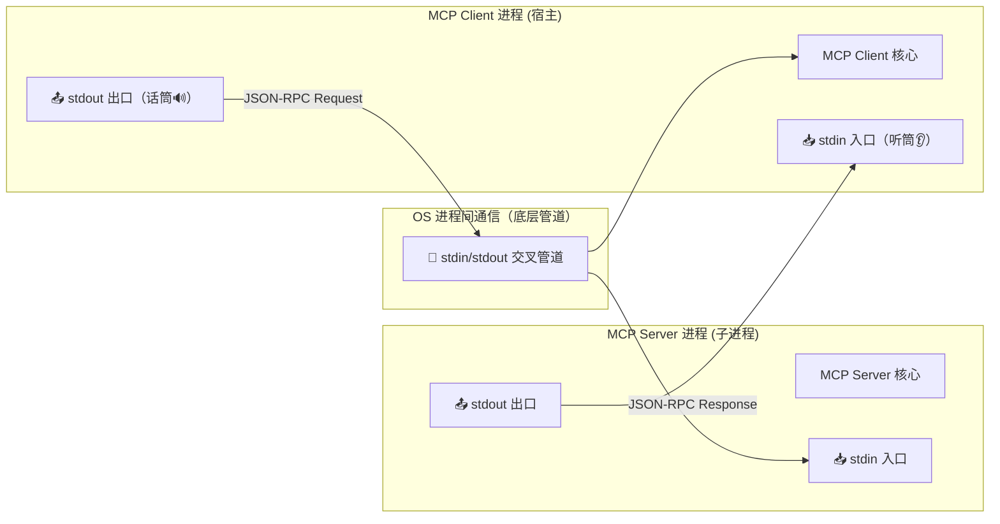

> [!summary] 一句话
> MCP 的 **stdio 模式** = 「主进程 Client + 子进程 Server」通过操作系统的 stdin/stdout **交叉管道**通信，传输层是 stdio，协议层是 **JSON-RPC 2.0**。

## 1. 核心架构（老板 vs 员工）

| 概念 | 角色 | 解释 |
|------|------|------|
| **MCP Client** | 老板 / 主进程 | 宿主程序（Claude Desktop、Cursor、VS Code），负责**启动**子进程并管理其生命周期 |
| **MCP Server** | 员工 / 子进程 | 由 Client 用 `npx`/`python` 拉起的独立进程，处理请求后写回 stdout |
| **transport（传输层）** | 对讲机线 | stdin/stdout 就是操作系统的两条管道（pipe） |
| **protocol（协议层）** | 说话语言 | JSON-RPC 2.0；每条消息打包成**一行**（含 `\n`），按顺序发送 |

### 交叉管道连接（关键）
- **Client `stdout` → Server `stdin`**：客户端发请求
- **Server `stdout` → Client `stdin`**：服务器回响应
- **stderr 只写日志**：Server 的日志/错误必须走 stderr，否则会污染 stdout 的协议流导致客户端无法解析 JSON-RPC

## 2. 为什么 MCP Server 是子进程？

1. **隔离与安全**：独立内存空间，Server 崩溃/溢出/恶意代码不会拖垮宿主
2. **跨语言支持**：Python/Node/Go/Rust 都能用标准管道驱动，无需 API 绑定
3. **生命周期管理**：进程是可启动/暂停/杀死的最小执行单位，本地工具轻量
4. **权限与资源限制**：可为子进程套沙箱、限制目录访问、分配资源

> HTTP 模式下 Server 是独立远程服务（不一定是子进程）；但本地开发标准就是 **stdio + JSON-RPC + 子进程**。

## 3. 常见误解纠正

- ❌ "Client 通过 stdin 接收请求" → 错。请求由 Client 从 stdout 发出，Server 从 stdin 接收；Client 的 stdin 用于**接收 Server 的 stdout 响应**。
- ⚠️ 图中常漏画 stderr——日志走 stderr 是最佳实践，否则污染协议流。

## 相关笔记
- [[AI大模型/mcp/DeepSeek-MCP与FastMCP区别|MCP官方SDK 与 FastMCP 区别]]
- [[AI大模型/mcp/DeepSeek-MCP传输协议对比|MCP传输协议对比 SSE 与 Streamable HTTP]]
- [[AI大模型/mcp/Streamable HTTP 对比 SSE|Streamable HTTP 对比 SSE]]