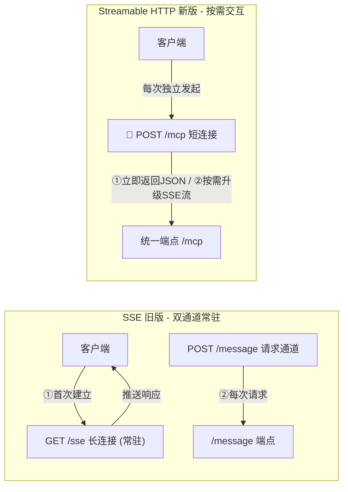

> [!summary] 一句话
> **SSE**（旧，2024）= 双通道常驻长连接；**Streamable HTTP**（新，2025）= 统一端点 `/mcp` 按需建立、无状态。核心差异是"连接是否常驻"与"会话如何管理"。

## 1. 两种协议本质

| 维度 | SSE（旧标准） | Streamable HTTP（新标准，官方推荐） |
|------|------|------|
| **地位** | 2024 旧版（已弃用） | 2025 年起官方推荐 |
| **通信模式** | 双通道：`GET /sse`（推送）+ `POST /message`（请求） | 统一端点 `/mcp`，按需双向 |
| **连接模型** | **常驻长连接**，有状态 | **按需短连接**，支持无状态 |
| **会话状态** | 隐含在长连接中，断线即失忆 | 显式 `Mcp-Session-Id` 头，可恢复 |
| **资源效率** | 高并发下 TCP 连接数暴涨（1000 并发时延从 18ms→1.5s+） | 空闲零占用，连接少、效率高 |
| **Serverless** | 难以部署（防火墙/代理不友好） | 无缝部署（纯 HTTP） |
| **负载均衡** | 需粘性会话（Sticky Session） | 任意路由 + 共享存储水平扩展 |

## 2. 请求/响应路径差异（易误解重点）

- **SSE**：**请求走 POST 通道，响应走 SSE 通道**。两条通道必须同时存活，用 sessionId 关联。
- **Streamable HTTP**：**请求和响应走同一连接闭环**；只有长任务需要实时流式输出时才临时升级为 SSE 流，流完即关。

## 3. 决策指南

- **新项目 / 高并发 / Serverless** → **Streamable HTTP**（强烈推荐）
- **仅兼容旧版客户端且并发低** → SSE
- **过渡期** → 两种协议同时支持

> 深层哲学：SSE 是"随时待命"（闲置也占专线，发费用）；Streamable HTTP 是"按劳分配"（无事零占用，成本随调用量计费）。新协议把"被 SS E 牺牲掉的 HTTP 无状态本质"重新拿了回来。

## 相关笔记
- [[AI大模型/mcp/Streamable HTTP 对比 SSE|Streamable HTTP 对比 SSE]]
- [[AI大模型/mcp/DeepSeek-MCP接入代码示例|MCP接入代码示例与LangChain集成]]
- [[AI大模型/mcp/DeepSeek-MCP-stdio模式解析|MCP stdio 模式解析]]