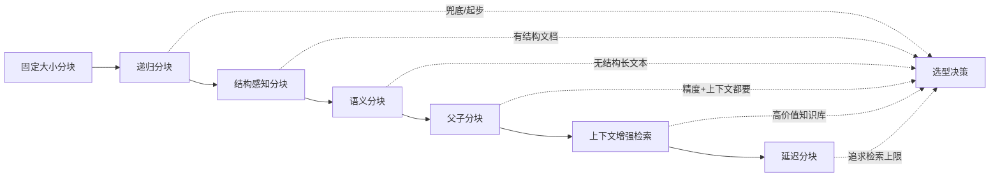

# RAG 中的分块策略

> [!abstract] 我的思考框架
> **分块发展脉络**：固定大小 → 递归分块 → 结构感知分块（markdown、html、代码等）→ 语义分块 → 父子分块 → 上下文增强检索 → 延迟分块
>
> **选择什么策略，先看文档类型**：技术文档、研究报告、长篇小说、PDF、FAQ、高价值离线知识库等

分块的每一步演进，都是在解决上一步遗留下的痛点。本文按这条主线展开，最后给出按文档类型的选型指南。

---

## 一、分块要解决的核心矛盾

分块的本质是在两个目标之间做权衡：

| 目标 | 要求 | 冲突点 |
|------|------|--------|
| **检索精度** | 块越小，单个 chunk 越聚焦，命中越精准 | 小块容易丢失上下文，命中但不完整 |
| **上下文完整性** | 块越大，信息越完整，LLM 回答越准确 | 大块噪音多，且受 embedding 模型输入长度限制 |

- **硬约束**：embedding 模型有最大输入长度（如 512 token）；超长直接截断或报错。
- **软约束**：chunk 太碎 → 语义被切碎、检索召回一堆碎片；chunk 太大 → 向量被"稀释"、语义模糊、噪音多。

> [!note] 一个关键认知
> **分块质量决定了 RAG 检索效果的上限**。后面所有策略（向量化、检索、重排）都是在"块已切好"的前提下工作。块切错了，后面再优化也补不回来。

---

## 二、演进全景一览



| 代际 | 策略 | 核心思想 | 解决什么 | 主要成本 |
|------|------|----------|----------|----------|
| 1 | 固定大小分块 | 按 token/字符数硬切 | 最基础的可用方案 | 破坏语义 |
| 2 | 递归分块 | 按分隔符层级递归切 | 尽量贴合语义单元 | 仍不懂内容 |
| 3 | 结构感知分块 | 利用文档自带结构 | 有结构文档的天然边界 | 依赖文档结构 |
| 4 | 语义分块 | 按向量相似度找话题边界 | 无结构文本的语义切分 | 计算量大、阈值难调 |
| 5 | 父子分块 | 小块检索、大块喂 LLM | 检索粒度 vs 上下文矛盾 | 存储翻倍、维护映射 |
| 6 | 上下文增强检索 | 为每个块注入全局上下文 | 单块脱离文档语境 | LLM 调用成本高 |
| 7 | 延迟分块 | 先整篇编码、再向量切分 | 从编码层面解决上下文 | 内存/计算成本最高 |

---

## 三、演进详解

### 第 1 代：固定大小分块（Fixed-size Chunking）

**核心思想**：不看内容，按固定 token 数或字符数硬切，可加重叠（overlap）防边界截断。

```python
def fixed_chunking(text, chunk_size=500, overlap=50):
    chunks = []
    for i in range(0, len(text), chunk_size - overlap):
        chunks.append(text[i:i + chunk_size])
    return chunks
```

**演进动机**：从"零"到"有"，最快跑通 RAG 的方案。

- ✅ 优点：实现极简、可控、速度快、无额外计算。
- ❌ 缺点：**完全无视语义**，可能从句子中间、甚至词语中间切断；两个语义相连的内容被拆开，检索时"答非所问"。
- 🎯 适用：快速原型、测试链路、内容本身无结构的占位方案。

> 分块大小和重叠的具体取值参考 [[AI大模型/rag/分块策略/RAG中 分块(chunk)和重叠(overlap) 大小怎么定|RAG中 分块(chunk)和重叠(overlap) 大小怎么定]]。

---

### 第 2 代：递归分块（Recursive Chunking）

**核心思想**：按**分隔符的优先级**逐级递归切分——先按 `\n\n`（段落）、再按 `\n`（行）、再按 `.`（句子）、最后按空格，保证切出的块尽量是"完整语义单元"。

```python
# LangChain RecursiveCharacterTextSplitter 的思路
def recursive_chunking(text, separators=["\n\n", "\n", ".", " "], chunk_size=500):
    def split(text, sep_idx):
        if len(text) <= chunk_size or sep_idx >= len(separators):
            return [text] if text else []
        parts = []
        # 用当前分隔符切，逐段拼到接近 chunk_size
        segments = text.split(separators[sep_idx])
        buf = ""
        for seg in segments:
            if len(buf) + len(seg) > chunk_size and buf:
                parts.extend(split(buf, sep_idx + 1))  # 装不下就降级到下一级分隔符
                buf = seg
            else:
                buf += seg + separators[sep_idx]
        if buf:
            parts.extend(split(buf, sep_idx + 1))
        return parts
    return split(text, 0)
```

**演进动机**：固定大小把"段落""句子"从中切开，递归分块利用自然分隔符，尽量**在语义边界切**，且块长可控制在目标大小附近。

- ✅ 优点：不依赖结构、通用性强、切分质量显著好于硬切；实际落地使用最广。
- ❌ 缺点：只依赖**标点/换行**这类表层信号，不理解内容；"话题变了但文本连续"时依然切不中。
- 🎯 适用：绝大多数无明确结构的普通文本，是"默认起步方案"。

---

### 第 3 代：结构感知分块（Structure-aware Chunking）

**核心思想**：**文档自带结构就是最好的边界**。按 Markdown 标题、HTML 标签、代码函数/类、PDF 段落等层级切分。

```python
# Markdown 按标题层级切分
def markdown_chunking(md_text):
    chunks = []
    current = {"level": None, "text": []}
    for line in md_text.splitlines():
        if line.startswith("#"):            # 遇到标题
            if current["text"]:             # 收尾上一个 section
                chunks.append("\n".join(current["text"]))
            current = {"level": line.count("#"), "text": [line]}
        else:
            current["text"].append(line)
    if current["text"]:
        chunks.append("\n".join(current["text"]))
    return chunks
```

常见工具：
- **Markdown**：按 `#`~`####` 标题层级切（`MarkdownHeaderTextSplitter`）。
- **HTML**：按 `<h1>/<h2>/<p>/<div>` 等标签切。
- **代码**：按函数、类、import 块切（`PythonCodeTextSplitter`、`LatexTextSplitter`）。
- **PDF**：按页面 + 段落 + 标题（依赖解析器输出）。

**演进动机**：很多真实文档（README、技术手册、网页）**自带结构信息**，放着不用很浪费。按结构切，块与块之间天然语义独立，还免费获得"标题作为元数据"。

- ✅ 优点：边界准确、块内高度连贯；标题可当 chunk 元数据，辅助检索与展示。
- ❌ 缺点：依赖文档有结构；同一文档结构不统一时（如 PDF 排版混乱）效果差。
- 🎯 适用：**技术文档、Markdown/HTML 知识库、代码库、结构化报告**。

---

### 第 4 代：语义分块（Semantic Chunking）

**核心思想**：不做"表面切分"，而是用 embedding 计算**相邻句子的语义相似度**，相似度骤降处（话题转折点）即切分点。

```python
# 核心流程：先切句 → 算相似度 → 动态阈值 → 切块
similarities = [cosine_sim(vec[i], vec[i+1]) for i in range(len(sentences)-1)]
threshold = np.percentile(similarities, 25)   # 动态阈值，而非固定 0.5
chunks = split_at_positions(sentences, [i+1 for i, s in enumerate(similarities) if s < threshold])
```

**演进动机**：递归/结构感知都依赖"表层信号"，对**无结构的长文本**（小说正文、研究报告叙述段）无能为力——它们话题切换是连续、无标题的。语义分块直接看"意思"。

- ✅ 优点：真正按话题切，块内语义高度统一；适合长叙事文本。
- ❌ 缺点：每对相邻句子都要编码，**计算量大、速度慢**；阈值需要动态选择（百分位 / 拐点 / GMM），调不好会切得过碎或漏切。
- 🎯 适用：**长篇小说、无标题的长报告、对话、混合话题文档**。

> 动态阈值方法、完整代码见 [[AI大模型/rag/分块策略/语义分块与延迟分块详解#四、动态阈值选择（语义分块的进阶优化）|语义分块与延迟分块详解]]。

---

### 第 5 代：父子分块（Parent-Child / Small-to-Big Chunking）

**核心思想**：同时保留**小块**和**大块**两级（或多级），**用小块检索、把对应的大块喂给 LLM**。

```
检索时：  小 chunk 1 → 命中（粒度精准）
输出时：  ↑ 映射到父 chunk（含完整上下文） → 交给 LLM

Parent chunk  ──┬── child chunk 1   ← embedding 索引
                ├── child chunk 2
                └── child chunk 3
```

```python
# 父子分块：建立 child → parent 映射
children = semantic_chunking(doc, small=True)      # 小块：用于检索
parents  = structural_chunking(doc, large=True)    # 大块：用于生成
child_to_parent = map_child_to_parent(children, parents)

def retrieve(query, k=5):
    hit_children = vector_search(query, children, k)     # 命中小块的 embedding
    return [child_to_parent[c] for c in hit_children]    # 返回父块给 LLM
```

**演进动机**：语义分块切出的块虽语义一致，但**块太小会丢失上下文**（指代、"这个结论基于前文"）。父子分块用"双粒度"化解矛盾：**小粒度保证检索精度，大粒度保证上下文完整**。

- ✅ 优点：同时拿到"准"和"全"；是小块 vs 大块矛盾的标准解。
- ❌ 缺点：存储翻倍（两个粒度都要存）、需维护映射关系；父块可能过大。
- 🎯 适用：**对检索精度和回答质量都有要求的通用 RAG**，是目前工业界最主流的方案之一。

> 在 [[AI大模型/rag/RAG检索策略全面解析#1.1 文本分块（Chunking）|RAG检索策略全面解析]] 中也叫"层次化索引"或"摘要 + 原文双层索引"。

---

### 第 6 代：上下文增强检索（Contextual Retrieval）

**核心思想**：每个 chunk 脱离文档后经常**"缺上下文"**——比如一个 chunk 里只有"它被部署到生产环境"，读者不知道"它"是什么。用 LLM 为每个 chunk 生成一段**文档级上下文**，与 chunk 一起 embedding、一起存储：

```
原始 chunk:  "它的延迟降低了 30%"
生成 context: "该文本来自《系统性能优化报告》第三节，讨论将缓存中间件 Redis 引入架构后的效果。
               这里的'它'指 Redis 缓存层。它的延迟降低了 30%。"
最终索引:    [context] + [原始 chunk] 一起编码
```

**演进动机**：父子分块给了 chunk 更大篇幅，但 **chunk 本身还是独立编码的**，检索时依然可能因为"语境缺失"而匹配不上。上下文增强从**内容层面**给每个块补上全局语境，让 embedding 和 BM25 都能命中。

- ✅ 优点：显著提升检索命中率（Anthropic 官方数据显示失误率降低约 49%）；实现直接，与任何检索方式兼容。
- ❌ 缺点：每个 chunk 都要一次 LLM 调用，**成本高、耗时长**；context 质量依赖 prompt 设计。
- 🎯 适用：**高价值离线知识库**（可承受一次性索引成本）、对召回率要求极高的场景。

> 同类思路：**假设问题生成**（为每个块生成可能的问句）、**摘要附加**（摘要 + 原文双层索引），在 [[AI大模型/rag/RAG检索策略全面解析#1.2 检索增强策略|RAG检索策略全面解析]] 中有涉及。

---

### 第 7 代：延迟分块（Late Chunking）

**核心思想**：颠覆"先切后编码"的顺序——**先把整篇文档一次性编码**，让每个句子的向量都**融合全文上下文**，再在向量空间里检测"断层"切分。

```
传统分块： 切块 → 每块独立编码（块间无上下文）
延迟分块： 整篇编码 → 得到带全局上下文的句子向量 → 在向量空间切分
```

```python
def late_chunking(document):
    sentences = split_sentences(document)                     # 只标记位置，不切
    vecs = model.encode_with_context(sentences, document)     # 关键：整篇输入，句子向量含全文语境
    change_points = rpt.Pelt(model="l2").fit(vecs).predict(penalty=10)  # 向量空间检测断层
    return split_by_indices(sentences, change_points)          # 回溯原文切分
```

**演进动机**：上下文增强检索是"事后补上下文"（文本层面、成本高）；延迟分块是"**编码时就带上下文**"（向量层面、更根本）。模型如 `jina-embeddings-v3`、`ColBERT`、`LongFormer` 天然支持。

- ✅ 优点：每个句子向量都是全局视角，**天然解决指代消解**；切分基于向量分布更准确；只编码一次。
- ❌ 缺点：需要支持上下文感知编码的模型；**内存/计算成本最高**（需缓存全篇向量）；实现复杂度高。
- 🎯 适用：**高价值离线知识库、追求检索精度的上限场景**；对实时性要求不高的离线索引。

> 完整对比与代码见 [[AI大模型/rag/分块策略/语义分块与延迟分块详解|语义分块与延迟分块详解]]，相关模型原理见 [[AI大模型/rag/ColBERT深度解析|ColBERT深度解析]]。

---

## 四、如何选择：先看文档类型

> [!important] 选型原则
> **先跑通，再优化。** 不要一上来就用最贵的方案。默认从递归分块起步，跑出基线，再按文档类型和评估指标逐级升级。

### 按文档类型的推荐表

| 文档类型 | 首选策略 | 理由 | 备选/进阶 |
|----------|----------|------|-----------|
| **技术文档**（README、API、手册） | 结构感知分块（Markdown/标题） | 天然有标题层级，边界准确，标题可当元数据 | 递归分块兜底 |
| **研究报告** | 结构感知 + 语义分块 | 有章节结构，但正文段落长、话题连续 | 父子分块兼顾精度与完整性 |
| **长篇小说** | 语义分块 | 无结构、叙事连续，话题边界靠语义 | 延迟分块（预算充足时） |
| **PDF** | 结构感知（段落 + 标题） | 依赖解析器输出，先保证解析质量 | 固定大小兜底 + 重叠 |
| **FAQ / 问答对** | 结构感知（按"问-答"对切） | 一个问答就是完整语义单元，别拆散 | 固定大小 + 大重叠 |
| **代码仓库** | 结构感知（按函数/类切） | 语法边界 = 语义边界 | 递归分块兜底 |
| **高价值离线知识库** | 延迟分块 / 上下文增强检索 | 可承受高成本，追求检索上限 | 父子分块作为性价比之选 |
| **混合文档库** | 递归分块起步 + 按类型分流 | 不同类型用不同策略，路由到对应 pipeline | 父子分块统一收口 |

### 决策树

```
文档有明确结构吗（标题/标签/代码块）？
├─ 有 ──→ 结构感知分块
└─ 无 ──→ 递归分块起步
             │
             └─ 评估 hit rate 不满意？
                  ├─ 是 → 语义分块（长文本/话题连续）
                  └─ 否 → 保持，关注下一步

检索"准"但回答"不完整"？
├─ 是 → 父子分块（小块检索 + 大块输出）

知识库高价值、预算充足、要极限召回？
├─ 是 → 上下文增强检索 或 延迟分块
└─ 否 → 父子分块 已足够
```

### 几个实用原则

1. **按类型分流**：真实知识库往往混合多种文档，先对文档分类，再路由到不同分块 pipeline，不要一套策略打天下。
2. **评估驱动**：用测试集看 **hit rate**（召回是否命中）和 **answer relevance**（回答是否贴题），对比不同策略再定。
3. **成本递进**：递归（免费）→ 结构感知（免费）→ 语义（有编码成本）→ 父子（存储成本）→ 上下文增强/延迟（LLM/计算成本）。在达到目标的前提下用最便宜的。
4. **与检索搭配**：分块策略不是孤立的，要配合 [[AI大模型/rag/RAG检索策略全面解析|检索策略]]（混合检索、重排）一起调优。

---

## 五、演进脉络背后的逻辑（回顾）

| 演进 | 底层想解决的事 |
|------|----------------|
| 固定大小 → 递归 | 从"硬切"到"尽量切在语义边界" |
| 递归 → 结构感知 | 从"通用分隔符"到"利用文档自带结构" |
| 结构感知 → 语义 | 从"表层信号"到"理解内容" |
| 语义 → 父子 | 从"单粒度"到"检索小、输出大" |
| 父子 → 上下文增强 | 从"给更大块"到"给块补全局语境" |
| 上下文增强 → 延迟分块 | 从"事后文本层面补"到"编码层面直接带上下文" |

> 一句话：**分块演进 = 越来越懂语义 + 越来越完整地保留上下文 + 成本越来越高**。选型就是在这条曲线上找一个性价比最高的点。

---

## 相关笔记

- [[AI大模型/rag/分块策略/语义分块与延迟分块详解|语义分块与延迟分块详解]]
- [[AI大模型/rag/分块策略/RAG中 分块(chunk)和重叠(overlap) 大小怎么定|RAG中 分块(chunk)和重叠(overlap) 大小怎么定]]
- [[AI大模型/rag/RAG检索策略全面解析|RAG检索策略全面解析]]
- [[AI大模型/rag/ColBERT深度解析|ColBERT深度解析]]
