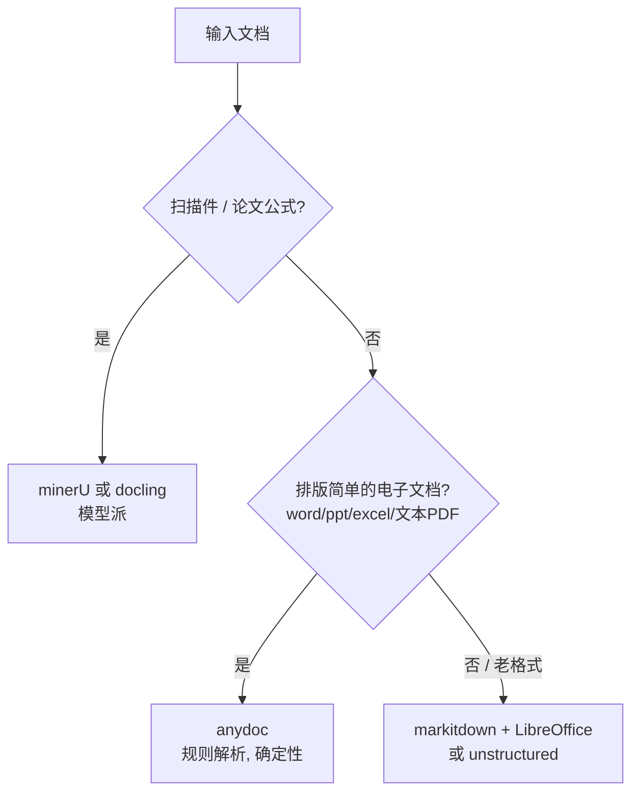

# 📄 文档解析工具选型思路（RAG 知识摄入）

> [!abstract] 一句话结论
> **普通电子文档（word / ppt / excel、简单排版文本 PDF）优先用 `anydoc`**：规则解析、确定性、快、单二进制、占用少、可涉密。只有遇到扫描件、复杂版面、公式等规则处理不了的场景，才回退到 `unstructured` / `docling` / `minerU` 这类重型方案。

---

## 🧠 它在 RAG 里的位置

```
文档  →  ⬇️ 文档解析 / 知识摄入（Ingestion）  →  分块(chunk)  →  向量化  →  检索
              ↑ 本条笔记关注的第一环
```

文档解析是 RAG 摄入的**第一环**，其质量直接决定后续分块、向量化、检索的效果。**解析阶段的脏数据会一路污染到 embedding 和检索**——所以解析阶段就应尽量避免引入不可控的错误。

---

## 🧵 三大流派对比

### 1. 缝合怪派：markitdown（Microsoft 开源）
- 一套库把常见格式统一转成 Markdown
- 依赖：`.docx` 走 `python-docx`、`.pptx` 走 `python-pptx`、PDF 走 pdfplumber
- 缺点：**老版 .doc / .ppt 二进制格式不支持**，需先用 LibreOffice 转成新格式
- 定位：轻量、格式覆盖面广，但**深度不足**（复杂排版易丢失结构）

### 2. ETL 派：unstructured
- 功能**最全**，适合文档 ETL 管道
- 依赖栈：`libmagic`、`poppler`、`tesseract`、`libreoffice`、`pandoc`
- 缺点：依赖太重；**容器第一次调用会失败**——根因分两层：
  - **① 运行时模型下载**（社区最常报）：首次 `partition()` 会在运行时下载 **NLTK 分词数据（punkt_tab）+ spaCy 模型**，走网络；离线/网络受限/目录只读即失败（issue \#3511、\#3967、\#3795、\#3617，报 `Resource "punkt_tab" not found` / 403）
  - **② 子进程调外部二进制**（你怀疑的维度）：unstructured 对 office 文档会 `subprocess` 调 **LibreOffice（soffice）**、对 PDF 调 **poppler**、OCR 调 **tesseract**；精简容器未装这些，第一次解析到对应格式就报 `FileNotFoundError: soffice command was not found`（issue \#2500）
  - 官方 Docker 镜像已内置两者，主要踩坑在**自定义/精简容器**。规避：官方镜像 / 预下载模型 / 预装外部二进制并预热

### 3. 模型解析派：docling / minerU
- **docling**（IBM 出品）：基于 PyTorch + DETR 版面模型，结构化输出强（表格→HTML/CSV）
  - 一个 worker 吃 **4–6G 显存**
  - CPU 转一页要 **1 秒多**，慢
- **minerU**（上海 AI Lab OpenDataLab 出品）：专攻**扫描件 + 论文公式**（OCR + 公式识别）
  - 更慢，且**模型不确定性**强（同输入两次结果可能不同；错误多为"软错误"，静默错字难察觉）

---

## ✅ 推荐路径：普通电子文档用 anydoc

> [!info] 已核实的官方事实（firecrawl/anydoc，16364⭐，Rust）
> - **8 种格式族 / 14 种扩展名**：Word(doc/docx/docm)、PowerPoint(ppt/pps/pot/pptx/pptm/ppsx/ppsm)、Excel(xls/xlsx/xlsm/xlsb)、OpenDocument(odt/ods/odp)、RTF、EPUB、CSV、PDF → 统一转 GFM Markdown
> - **原生支持老版 .doc/.ppt/.xls**（这点比 markitdown 强，markitdown 需先 LibreOffice 转）
> - **纯 Rust、无 ML、无外部服务** → 确定性、可复现（官方基准中位 **4.4ms/份**，比 unstructured 572ms / markitdown 134ms / docling 513ms 快 1–2 个数量级）
> - **单预编译二进制**（npx 首次运行下载对应平台二进制）
> - 直接依赖 **9 个**：calamine、cfb、csv、flate2、encoding_rs、log、pdf-inspector、quick-xml、zip
> - 官方解析质量基准分 **81/100**，14/14 格式全覆盖，各格式均为参测最高分

- **覆盖**：word、ppt、excel 等 8 种格式族，基于**规则**解析
- **优点**：
  - 解析**快**（中位 4.4ms/份）
  - 仅 **9 个直接 Rust 依赖**，**一个二进制**，占用少，部署简单
  - **可涉密**（本地规则解析，不上传不外发）
  - **确定性**：无 ML、无外部服务，同一输入结果**可复现**，可做增量索引
- **缺点**：
  - PDF 解析基于内置 `pdf-inspector`，**只能处理文本型 PDF**
  - **扫描件（无 OCR）直接报错** `ConvertError::Encrypted | Unsupported`——但这是**明确拒绝**（硬错误），不产生脏数据，行为可预期

---

## ⚖️ 核心洞察：确定性 vs 概率性

这是整份笔记最有价值的一条**选型准则**：

| 维度 | 规则解析（anydoc） | 模型解析（docling / minerU） |
|------|-------------------|------------------------------|
| 结果 | **确定性**，可复现 | **概率性**，同输入可能不同 |
| 错误 | **硬错误**：明确拒绝，可预期 | **软错误**：静默错字，难察觉 |
| 索引 | 可增量、稳定 | 重排/重跑结果会漂移 |
| 代价 | 低（快、省资源） | 高（慢、吃显存/CPU） |
| 适用 | 简单排版电子文档 | 扫描件、复杂版面、公式 |

**选型准则**：能确定性地解析就**优先确定性**，把模型留给"规则做不了"的场景（扫描件、复杂版面、公式）。避免把模型不确定性引入到所有文档。

---

## 🧭 选型决策流



| 场景 | 推荐 |
|------|------|
| 普通电子文档（word/ppt/excel，含老版 .doc/.ppt/.xls）、文本 PDF | ✅ **anydoc**（原生覆盖老格式） |
| 需要转 Markdown 的轻量场景 / 不想引入 Rust 二进制 | markitdown（老格式需 + LibreOffice 预处理） |
| 复杂版面 / 需要完整 ETL | unstructured（注意首调模型下载 + 外部二进制） |
| 扫描件 / 论文公式 | docling（通用）/ minerU（专门，但慢+不确定） |

> [!tip] 一句话记忆
> **先轻后重**：用轻的规则解析解决 80% 场景（anydoc），把重模型留给真正需要它的少数场景。

---

## 📎 相关笔记

- [[AI大模型/rag/RAG系统核心技术与实现|RAG系统核心技术与实现]] — RAG 系统全流程
- [[AI大模型/rag/分块策略/RAG中的分块策略|RAG 中的分块策略]] — 摄入后的分块环节
- [[AI大模型/rag/RAG检索策略全面解析|RAG检索策略全面解析]] — 下游检索策略
- [[AI大模型/AI大模型-MOC|AI 大模型总览]]