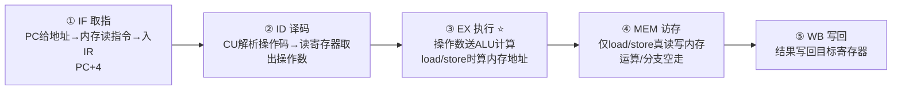

# CPU 指令完整执行流程详解

> [!note] 一句话总结
> CPU **每执行一条指令**要走完 5 个阶段：**取指(IF) → 译码(ID) → 执行(EX) → 访存(MEM) → 写回(WB)**。其中 ALU 在 EX 阶段负责所有计算（含算内存地址），而 **MEM 阶段只在读/写内存的指令（load/store）里才真正干活**，运算类和分支指令的 MEM 只是流水线占位空走。

> [!tip] 配图
> 完整流程图见配套 Canvas：`![[CPU指令执行流程.canvas]]`，含 CPU 部件、5 级流水线、MEM 对比。

---

## 目录

1. [部件全览：CPU 里都有谁](#1-部件全览cpu-里都有谁)
2. [5 级流水线流程详解](#2-5-级流水线流程详解)
3. [以 add 为例走一遍完整流程](#3-以-add-为例走一遍完整流程)
4. [MEM 访存阶段什么时候用](#4-mem-访存阶段什么时候用)
5. [四大类指令各阶段行动对比表](#5-四大类指令各阶段行动对比表)
6. [通俗记忆](#6-通俗记忆)
7. [流水线重叠补充](#7-流水线重叠补充)
8. [易混淆点排查](#8-易混淆点排查)

---

## 1. 部件全览：CPU 里都有谁

| 部件 | 全称/职责 | 主要工作 |
|------|-----------|----------|
| **PC** | 程序计数器 | 保存下一条要执行指令的内存地址；取指后自动 +4（32 位 CPU 一条指令 4 字节）指向下一条 |
| **IR** | 指令寄存器 | 暂存当前正在处理的这条指令 |
| **CU** | 控制单元 | 解析指令的操作码，发出各种控制信号，指挥各部件协调工作 |
| **通用寄存器组** | 寄存器堆 | 暂存要参与计算的数据和计算结果 |
| **ALU** | 算术逻辑单元 | **真正干活计算**：做加/减/与/或/异或/比较等运算，并设置状态标志位（是否溢出、结果为 0、正负） |
| **内存 RAM** | 主存 | 按地址存储指令和数据，供 CPU 读/写 |

> 一句话人设：**ALU 是 CPU 的计算器，寄存器是临时草稿本，CU 是发号施令的指挥官，PC 是"页码"，IR 是"当前正在读的这一页"。**

---

## 2. 5 级流水线流程详解

经典 **5 级流水线**模型：取指 IF → 译码 ID → 执行 EX → 访存 MEM → 写回 WB。

### ① 取指 IF（Instruction Fetch）— 把指令从内存读到 CPU
1. **PC** 给出下一条指令的内存地址，发到地址总线，访问内存。
2. 内存把对应地址的机器指令读出，送入 **IR 指令寄存器**。
3. **PC 自动 +4**，指向下一条指令地址。

### ② 译码 ID（Instruction Decode）— 解析指令 + 取数据
1. IR 里的指令送给 **CU 控制单元**解析操作码：判断是加法、减法还是加载数据。
2. 解析寄存器编号，从**通用寄存器组**读出两个源操作数（要参与计算的数据）。
3. 若是立即数指令，直接提取指令内部自带的常数。

> 例：`add r1, r2, r3` 表示 r1 = r2 + r3；译码阶段读出 r2、r3 的数值。

### ③ 执行 EX（Execute）— ALU 真正干活 ⭐
1. CU 发信号，把译码得到的操作数送入 **ALU**。
2. ALU 根据 CU 给出的运算类型（加/减/与/或/比较）完成运算。
3. ALU 输出结果，同时设置状态标志位（溢出、是否为 0、正负）。

> ✅ 到这里 ALU 计算已完成，但结果不一定已经写回寄存器。

### ④ 访存 MEM（Memory Access）— 可选，不是每条指令都用
- **运算指令（add/sub）**：不需要访问内存，本阶段空走，ALU 结果直接往下传递。
- **load（读内存）**：用 ALU 算出的内存地址，从内存读数据。
- **store（写内存）**：用 ALU 算出的内存地址，把数据写入内存。

### ⑤ 写回 WB（Write-Back）— 把结果放回寄存器
1. 将 ALU 结果 / 内存读出的数据，写回目标寄存器。
2. 寄存器更新完成，这条指令全部执行完毕。

---

## 3. 以 add 为例走一遍完整流程

指令 `add r1, r2, r3`（即 r1 = r2 + r3）：

| 阶段 | 动作 |
|------|------|
| **IF** | PC 给出地址，内存取出 add 指令放到 IR，PC+4 |
| **ID** | CU 译码知道是加法，读出 r2、r3 的值 |
| **EX** | 两个数送入 ALU，ALU 做加法，算出和 |
| **MEM** | 加法指令不碰内存，本阶段空跑 |
| **WB** | 把相加结果写回寄存器 r1 |

---

## 4. MEM 访存阶段什么时候用

> [!important] 核心结论
> **只有指令需要和主存 RAM 打交道（load / store）时，MEM 阶段才做真正的内存读写；运算类、分支指令的 MEM 只是流水线占位，不做操作。**

### ① Load 加载指令：从内存读数据到寄存器
示例 `lw r1, 100(r2)`：把内存地址 `r2+100` 处的数据读到 r1。
- **EX**：ALU 计算内存有效地址
- **MEM**：去内存读出这个数据 ✔
- **WB**：把读到的数据写回 r1

### ② Store 存储指令：把寄存器数据写到内存
示例 `sw r1, 100(r2)`：把 r1 的数据写入内存地址 `r2+100`。
- **EX**：ALU 计算内存有效地址
- **MEM**：把数据写入内存 ✔
- **WB**：store **没有写回寄存器**，WB 直接空操作

### ③ 不需要 MEM 干活的指令
- **算术逻辑指令** `add、sub、and、or、xor、slt`：只在寄存器之间运算。
  - IF → ID → EX（ALU 计算）→ **MEM 空周期** → WB 写回寄存器
- **分支指令** `beq r1, r2, label`（r1==r2 则跳转）：
  - EX：ALU 做减法比较，判断是否相等，并算出跳转目标地址
  - MEM：同样不访问内存，只判断是否跳转、修改 PC
  - WB：空操作

> [!tip] 极简记忆
> **只有读内存、写内存指令，MEM 才干活；其余指令 MEM 躺平。** 五级流水线流程仍要占满 5 步，但 MEM 内部没有内存读写动作。

---

## 5. 四大类指令各阶段行动对比表

> 原笔记末尾留下的"对比小表"，这里补齐。

| 指令类型 | 例子 | IF 取指 | ID 译码 | EX 执行 | MEM 访存 | WB 写回 |
|----------|------|---------|---------|---------|----------|---------|
| **算术/逻辑** | `add` | 读指令入 IR | 读寄存器操作数 | ALU 运算 | **空走** | 结果写回寄存器 |
| **Load 读内存** | `lw` | 读指令入 IR | 读寄存器/立即数 | **ALU 算地址** | **真读内存** | 内存数据写回寄存器 |
| **Store 写内存** | `sw` | 读指令入 IR | 读寄存器    | **ALU 算地址** | **真写内存** | **空走**（无写回） |
| **分支** | `beq` | 读指令入 IR | 读寄存器    | ALU 比较 + 算目标 | 空走（改 PC） | 空走 |

**一句话记忆**：`add` 的 ALU 算数、`lw/sw` 的 ALU **算地址**、`beq` 的 ALU **做比较**；只有 `lw/sw` 的 MEM 真读写内存，`sw` 和 `beq` 的 WB 是空操作。

---

## 6. 通俗记忆

1. **取**：从内存拿指令
2. **译**：读懂指令，拿数据
3. **算**：交给 ALU 做运算 ⭐
4. **访**：需要就读写内存
5. **存**：结果放回寄存器

> 💡 加一层联想：ALC（ALU 在 EX 算东西）是最核心的记忆点——**它既算数值，也算 lw/sw 的内存地址**。

---

## 7. 流水线重叠补充

现代 CPU 会**重叠执行**（流水线）：第 2 条指令取指时，第 1 条在译码，第 0 条在 ALU 执行……多条指令同时在流水线上不同阶段工作，从而大幅提升吞吐速度。理解单条指令的 5 阶段流程，是理解流水线并行的前提。

---

## 8. 易混淆点排查

- **ALU 是在 EX 阶段算地址！** MEM 不负责算地址；地址是 EX 里 ALU 算出来，交给 MEM 去访问内存。**ALU 算地址，MEM 完成真正内存读写。**
- **MEM 空走 ≠ 没有 MEM 阶段。** 流水线五级阶段仍要走完 5 步，只是 MEM 内部没有内存读写动作。
- **store 没有写回寄存器** → WB 是空操作（很多题在这里设坑）。
- **PC +4 是 32 位 CPU**（一条指令 4 字节）；具体数值随机器字长而定。

---

## 相关笔记

- [打开 Canvas](/CS%28%E8%AE%A1%E7%A7%91%29/%E7%BB%84%E6%88%90%E5%8E%9F%E7%90%86/CPU%E6%8C%87%E4%BB%A4%E6%89%A7%E8%A1%8C%E6%B5%81%E7%A8%8B.canvas) — 配套流程图
- [[AI大模型/大模型训练&微调&推理/模型推理/LLM推理优化完整知识梳理|LLM推理优化完整知识梳理]]