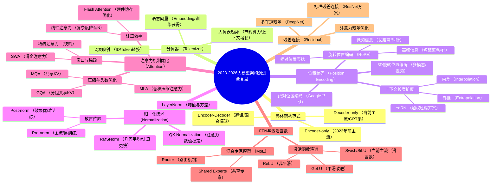

# 2023–2026 LLM架构的演进 Technical Roadmap

### 播放源

<iframe class="nlm-video" src="https://www.youtube.com/embed/jMz1NT4xScc" title="2023–2026 LLM架构的演进 Technical Roadmap" frameborder="0" allowfullscreen allow="accelerometer; autoplay; clipboard-write; encrypted-media; picture-in-picture"></iframe>

[在 YouTube 打开](https://www.youtube.com/watch?v=jMz1NT4xScc)

## 产物

### 思维导图

## 摘要

本文全面概述了 2023 
年以来大语言模型架构的演进，详细介绍了分词器、位置编码和注意力机制等关键技术组
件。它解释了现代模型如何将文本转换为数值表示，如何实现旋转位置编码以获取上下文
感知能力，以及如何利用归一化技术在训练期间保持数值稳定性。此外，该资料还探讨了
包括混合专家（Mixture-of-Experts）、激活函数和残差连接在内的各种优化，旨在提高
计算效率和扩展性能。最终，本教程梳理了基于 Transformer 
的系统的发展轨迹，阐明了结构上的优化改进如何持续提升当代人工智能的能力与效率。
