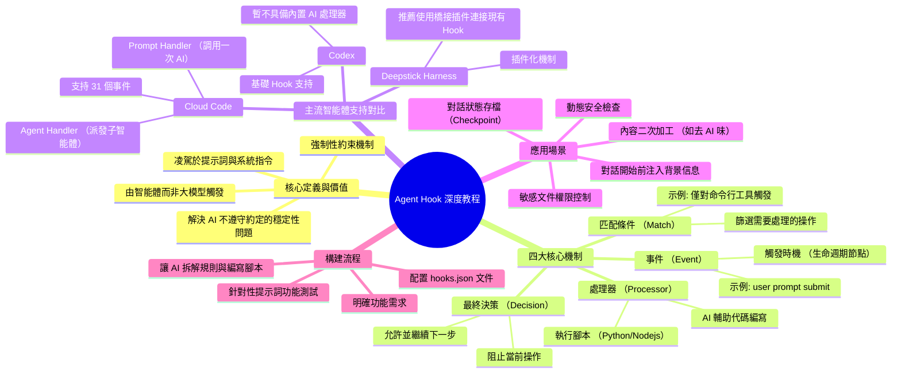

# Agent Hooks: 专业可靠的自动化控制机制

### 播放源

<iframe class="nlm-video" src="https://www.youtube.com/embed/vo5vqrtuThg" title="Agent Hooks: 专业可靠的自动化控制机制" frameborder="0" allowfullscreen allow="accelerometer; autoplay; clipboard-write; encrypted-media; picture-in-picture"></iframe>

[在 YouTube 打开](https://www.youtube.com/watch?v=vo5vqrtuThg)

## 产物

### 思维导图

### 信息图

点图看原图

### 演示文稿

<iframe src="https://pdf.hfhfn.dpdns.org/notebooklm/Agent%20Hooks_%20%E4%B8%93%E4%B8%9A%E5%8F%AF%E9%9D%A0%E7%9A%84%E8%87%AA%E5%8A%A8%E5%8C%96%E6%8E%A7%E5%88%B6%E6%9C%BA%E5%88%B6/slide-deck.pdf#view=FitH" class="nlm-slides" title="演示文稿" loading="lazy"></iframe>

[全屏打开](https://pdf.hfhfn.dpdns.org/notebooklm/Agent%20Hooks_%20%E4%B8%93%E4%B8%9A%E5%8F%AF%E9%9D%A0%E7%9A%84%E8%87%AA%E5%8A%A8%E5%8C%96%E6%8E%A7%E5%88%B6%E6%9C%BA%E5%88%B6/slide-deck.pdf)

## 摘要

Agent hooks 
提供了一种更为出色且强制性的约束机制，其独立于大语言模型运行，不同于 AI 
可能会忽略的传统 prompt 或配置文件。hook 
的核心架构由规定精确执行时机的事件、过滤特定操作的匹配条件、执行任务的处理器脚
本，以及决定是允许还是阻止当前操作的最终决策组成。虽然不同平台在原生支持上有所
差异——例如与其他系统相比，Cloud Code 能原生处理 AI 驱动的 prompt 和 agent 
handlers——但开发者可以通过明确定义其功能需求，成功构建自定义 
hook。通过建立这些自动化检查点，用户可以高效地执行动态安全规则、控制敏感文件访
问，并消除仅依赖对话指令的不确定性。
