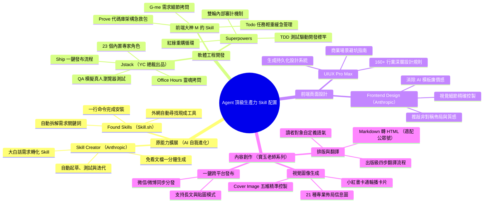

# Agent生产力:  四组 Skills

### 播放源

<iframe class="nlm-video" src="https://www.youtube.com/embed/diU-Nbb1P_c" title="Agent生产力:  四组 Skills" frameborder="0" allowfullscreen allow="accelerometer; autoplay; clipboard-write; encrypted-media; picture-in-picture"></iframe>

[在 YouTube 打开](https://www.youtube.com/watch?v=diU-Nbb1P_c)

## 产物

### 思维导图

### 信息图

点图看原图

### 演示文稿

<iframe src="https://pdf.hfhfn.dpdns.org/notebooklm/Agent%E7%94%9F%E4%BA%A7%E5%8A%9B_%20%E5%9B%9B%E7%BB%84%20Skills/slide-deck.pdf#view=FitH" class="nlm-slides" title="演示文稿" loading="lazy"></iframe>

[全屏打开](https://pdf.hfhfn.dpdns.org/notebooklm/Agent%E7%94%9F%E4%BA%A7%E5%8A%9B_%20%E5%9B%9B%E7%BB%84%20Skills/slide-deck.pdf)

## 摘要

（摘要生成中）
