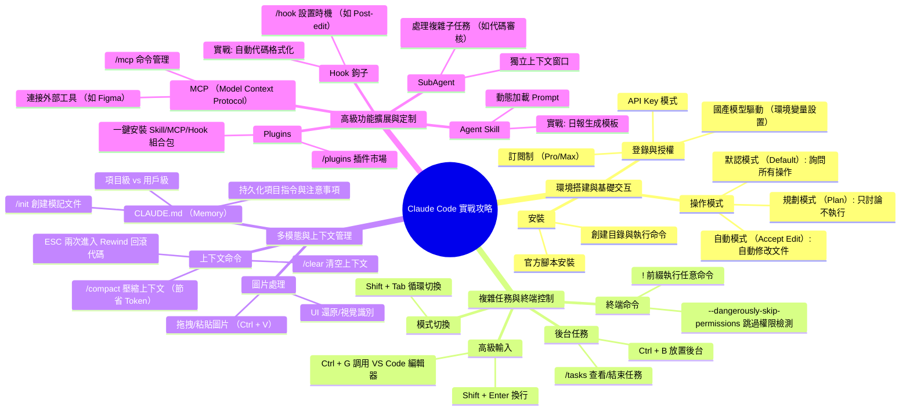

# Claude Code 从0到1全攻略

### 播放源

<iframe class="nlm-video" src="https://www.youtube.com/embed/AT4b9kLtQCQ" title="Claude Code 从0到1全攻略" frameborder="0" allowfullscreen allow="accelerometer; autoplay; clipboard-write; encrypted-media; picture-in-picture"></iframe>

[在 YouTube 打开](https://www.youtube.com/watch?v=AT4b9kLtQCQ)

## 产物

### 思维导图

### 信息图

点图看原图

### 演示文稿

<iframe src="https://pdf.hfhfn.dpdns.org/notebooklm/Claude%20Code%20%E4%BB%8E0%E5%88%B01%E5%85%A8%E6%94%BB%E7%95%A5/slide-deck.pdf#view=FitH" class="nlm-slides" title="演示文稿" loading="lazy"></iframe>

[全屏打开](https://pdf.hfhfn.dpdns.org/notebooklm/Claude%20Code%20%E4%BB%8E0%E5%88%B01%E5%85%A8%E6%94%BB%E7%95%A5/slide-deck.pdf)

## 摘要

所提供的文本提供了关于 Claude Code 的全面教程，Claude Code 
是一款旨在简化软件开发任务的高级编程 
Agent。它详细介绍了初始设置流程、基本交互，以及利用包括默认、自动和规划状态在内
的多种运行模式进行的界面导航。该指南还探讨了高级功能，例如通过 MCP 集成 
Figma、上下文压缩、自定义系统内存指令，以及用于自动代码格式化的 
hooks。此外，它还讲解了如何使用 Agent Skills、Subagents 和 Plugins 
扩展功能，以极高的效率构建复杂且可直接用于生产环境的应用程序。
