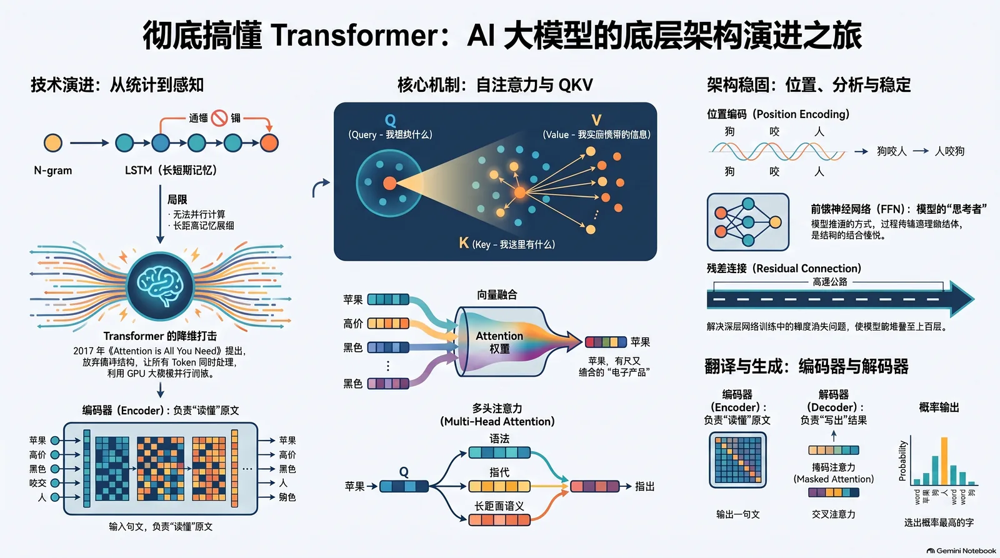

# Decoding Transformer Architecture: From Attention to QKV Mechanics

> 由 NotebookLM 笔记本导出的产物集合。

## 产物

- **思维导图**：`_assets/Decoding Transformer Architecture_ From Attention to QKV Mec/mind-map.json`
- **信息图**：

  
- **演示文稿**：[下载 PDF](https://pdf.hfhfn.dpdns.org/notebooklm/Decoding%20Transformer%20Architecture_%20From%20Attention%20to%20QKV%20Mec/slide-deck.pdf)

## 摘要

（在 NotebookLM 里点「摘要」复制正文粘到这里）
