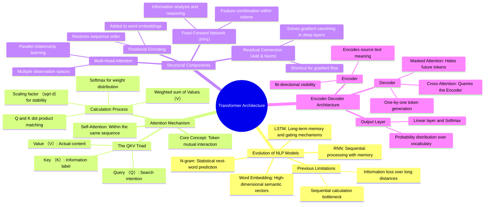

# Decoding Transformer Architecture: From Attention to QKV Mechanics

### 播放源

<iframe class="nlm-video" src="https://www.youtube.com/embed/jn7XU4OaIaE" title="Decoding Transformer Architecture: From Attention to QKV Mechanics" frameborder="0" allowfullscreen allow="accelerometer; autoplay; clipboard-write; encrypted-media; picture-in-picture"></iframe>

[在 YouTube 打开](https://www.youtube.com/watch?v=jn7XU4OaIaE)

## 产物

### 思维导图

### 信息图

点图看原图

### 演示文稿

<iframe src="https://pdf.hfhfn.dpdns.org/notebooklm/Decoding%20Transformer%20Architecture_%20From%20Attention%20to%20QKV%20Mec/slide-deck.pdf#view=FitH" class="nlm-slides" title="演示文稿" loading="lazy"></iframe>

[全屏打开](https://pdf.hfhfn.dpdns.org/notebooklm/Decoding%20Transformer%20Architecture_%20From%20Attention%20to%20QKV%20Mec/slide-deck.pdf)

## 摘要

Transformer 架构通过克服 RNNs 和 LSTMs 
等早期模型的顺序处理局限性，彻底改变了人工智能领域。通过引入由 Query (Q)、Key 
(K) 和 Value (V) 向量驱动的 self-attention 和 multi-head attention 
机制，该模型允许句子中的每个 token 
都能同时直接相互作用并交换信息。为了配合使该架构实现高效的并行处理，模型添加了 
positional encodings 以保留词序。此外，feed-forward networks、residual 
connections 和 masking 
等组件协同工作，以稳定深度训练并防止未来数据的过早泄露。最终，结合使用 
cross-attention 的 encoders 和 decoders 
能够胜任翻译和文本生成等复杂任务，构成了现代大语言模型背后的基础框架。
