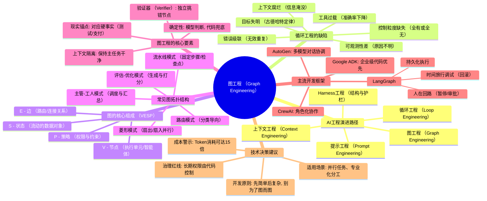

# From Loop to Graph: 工程可靠的多智能体系统

### 播放源

<iframe class="nlm-video" src="https://www.youtube.com/embed/8RedSkw1UjE" title="From Loop to Graph: 工程可靠的多智能体系统" frameborder="0" allowfullscreen allow="accelerometer; autoplay; clipboard-write; encrypted-media; picture-in-picture"></iframe>

[在 YouTube 打开](https://www.youtube.com/watch?v=8RedSkw1UjE)

## 产物

### 思维导图

### 信息图

点图看原图

### 演示文稿

<iframe src="https://pdf.hfhfn.dpdns.org/notebooklm/From%20Loop%20to%20Graph_%20%E5%B7%A5%E7%A8%8B%E5%8F%AF%E9%9D%A0%E7%9A%84%E5%A4%9A%E6%99%BA%E8%83%BD%E4%BD%93%E7%B3%BB%E7%BB%9F/slide-deck.pdf#view=FitH" class="nlm-slides" title="演示文稿" loading="lazy"></iframe>

[全屏打开](https://pdf.hfhfn.dpdns.org/notebooklm/From%20Loop%20to%20Graph_%20%E5%B7%A5%E7%A8%8B%E5%8F%AF%E9%9D%A0%E7%9A%84%E5%A4%9A%E6%99%BA%E8%83%BD%E4%BD%93%E7%B3%BB%E7%BB%9F/slide-deck.pdf)

## 摘要

图工程（Graph engineering）已成为人工智能（AI）领域的一项关键演进，超越了单 
Agent 循环，将多个 AI 实体组织成结构化的协作系统。尽管单个 Agent 
经常面临上下文退化（context degradation）、错误级联（error 
cascading）以及缺乏细粒度控制等问题，但基于图的架构通过将执行与验证分离并将流程
锚定于现实，解决了这些缺陷。这些框架利用用于特定任务的定义节点（nodes）、用于路
由的有向边（directional edges）以及共享状态（shared 
states）来维持干净、隔离的上下文，而不会超出 token 
限制。通过引入用于规则检查的确定性代码，并部署独立验证器（verifiers）对生成的结
论进行校验，系统实现了显著提高的可靠性和可审计性。最终，这种方法通过分工和建立
明确的制衡机制镜像了人类的组织管理，将孤立的 AI 
模型转化为可控且具备生产准备（production-ready）的工作流。
