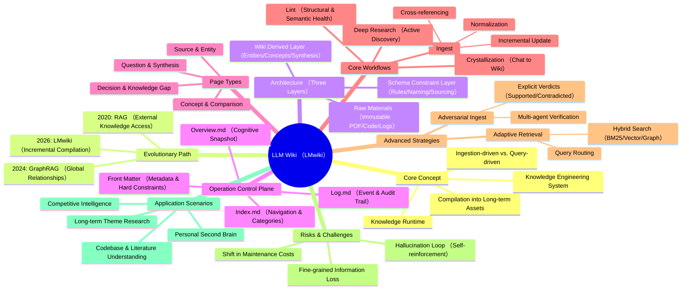

# LLM-Wiki：RAG与知识工程流程的演进

### 播放源

<iframe class="nlm-video" src="https://www.youtube.com/embed/g1Y7Rrz7u4k" title="LLM-Wiki：RAG与知识工程流程的演进" frameborder="0" allowfullscreen allow="accelerometer; autoplay; clipboard-write; encrypted-media; picture-in-picture"></iframe>

[在 YouTube 打开](https://www.youtube.com/watch?v=g1Y7Rrz7u4k)

## 产物

### 思维导图

### 演示文稿

<iframe src="https://pdf.hfhfn.dpdns.org/notebooklm/LLM-Wiki%EF%BC%9ARAG%E4%B8%8E%E7%9F%A5%E8%AF%86%E5%B7%A5%E7%A8%8B%E6%B5%81%E7%A8%8B%E7%9A%84%E6%BC%94%E8%BF%9B/slide-deck.pdf#view=FitH" class="nlm-slides" title="演示文稿" loading="lazy"></iframe>

[全屏打开](https://pdf.hfhfn.dpdns.org/notebooklm/LLM-Wiki%EF%BC%9ARAG%E4%B8%8E%E7%9F%A5%E8%AF%86%E5%B7%A5%E7%A8%8B%E6%B5%81%E7%A8%8B%E7%9A%84%E6%BC%94%E8%BF%9B/slide-deck.pdf)

## 摘要

LLMWiki 
代表了人工智能领域的一次范式转变，它从传统的查询驱动检索转向作为一个长期知识运
行时工作的增量编译系统。该架构不再将每次对话交互视为临时事件，而是利用结构化 
schema 
和原材料摄取，持续更新导航页面、操作控制文件以及交叉引用的资产。通过将内容组织
进不同的层级——包括不可变的原始数据、衍生 wiki 
知识和行为约束——该系统成功解决了传统工具高昂的维护成本以及缺乏持久资产保留的问
题。此外，高级实现方案还融合了对抗性摄取和多维验证流水线，以降低自我强化幻觉和
错误信息传播的风险。最终，这一框架将大语言模型从暂态的问答引擎提升为随时间推移
变得越来越聪明、越来越有条理的宝贵知识库。
