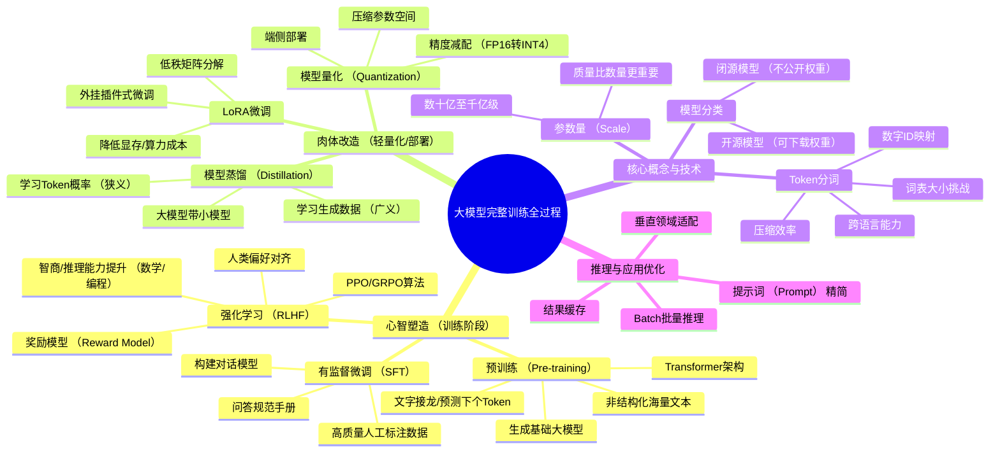

# Large Model Training Processes and Refinement Techniques

### 播放源

<iframe class="nlm-video" src="https://www.youtube.com/embed/FkYLL4L0BfY" title="Large Model Training Processes and Refinement Techniques" frameborder="0" allowfullscreen allow="accelerometer; autoplay; clipboard-write; encrypted-media; picture-in-picture"></iframe>

[在 YouTube 打开](https://www.youtube.com/watch?v=FkYLL4L0BfY)

## 产物

### 思维导图

### 信息图

点图看原图

### 演示文稿

<iframe src="https://pdf.hfhfn.dpdns.org/notebooklm/Large%20Model%20Training%20Processes%20and%20Refinement%20Techniques/slide-deck.pdf#view=FitH" class="nlm-slides" title="演示文稿" loading="lazy"></iframe>

[全屏打开](https://pdf.hfhfn.dpdns.org/notebooklm/Large%20Model%20Training%20Processes%20and%20Refinement%20Techniques/slide-deck.pdf)

## 摘要

构建先进的人工智能系统包含一个完整的生命周期，通过结构化的阶段将原始数据转化为
功能强大的应用程序。最初，工程师将非结构化文本处理成被称为 token 
的标准化数字单位，通过海量文本预测来构建基座模型。随后，开发者结合 supervised 
fine-tuning 
与人类偏好对齐技术，来塑造人工智能的行为和价值观。为了确保软件能够在标准硬件上
高效运行且不产生过高计算成本，从业者会应用诸如 parameter-efficient 
fine-tuning、knowledge distillation 和 quantization 
等专门的优化方法。最终，这些先进的流程成功地将庞大的参数架构转化为适用于日常消
费级设备和企业级部署的轻量、实用工具。
