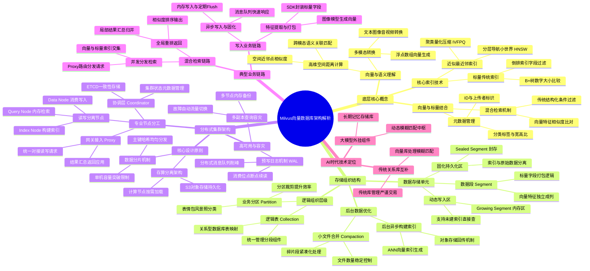

# Milvus 向量数据库架构和系统设计

### 播放源

<iframe class="nlm-video" src="https://www.youtube.com/embed/-hKHbHA0KKI" title="Milvus 向量数据库架构和系统设计" frameborder="0" allowfullscreen allow="accelerometer; autoplay; clipboard-write; encrypted-media; picture-in-picture"></iframe>

[在 YouTube 打开](https://www.youtube.com/watch?v=-hKHbHA0KKI)

## 产物

### 思维导图

### 信息图

点图看原图

### 演示文稿

<iframe src="https://pdf.hfhfn.dpdns.org/notebooklm/Milvus%20%E5%90%91%E9%87%8F%E6%95%B0%E6%8D%AE%E5%BA%93%E6%9E%B6%E6%9E%84%E5%92%8C%E7%B3%BB%E7%BB%9F%E8%AE%BE%E8%AE%A1/slide-deck.pdf#view=FitH" class="nlm-slides" title="演示文稿" loading="lazy"></iframe>

[全屏打开](https://pdf.hfhfn.dpdns.org/notebooklm/Milvus%20%E5%90%91%E9%87%8F%E6%95%B0%E6%8D%AE%E5%BA%93%E6%9E%B6%E6%9E%84%E5%92%8C%E7%B3%BB%E7%BB%9F%E8%AE%BE%E8%AE%A1/slide-deck.pdf)

## 摘要

所提供的来源全面解析了 Milvus 
向量数据库架构，解释了它如何通过将各种媒体转化为多维浮点向量来处理复杂的语义信
息。文中详细阐述了其层级化数据组织，将信息组织为表、分区和不可变的数据段，以优
化检索性能与存储效率。此外，说明中重点介绍了 Milvus 
的分布式系统设计，指出其采用存算分离、读写分离与消息队列来确保高可用性与弹性扩
展能力。通过将用于向量计算的近似最近邻索引与传统标量过滤相结合，该数据库有效地
弥合了模糊语义匹配与结构化数据查询之间的鸿沟。最终，来源将 Milvus 
定位为不可或缺的 AI 内存扩展，旨在补充而非替代传统的关系型数据库。
