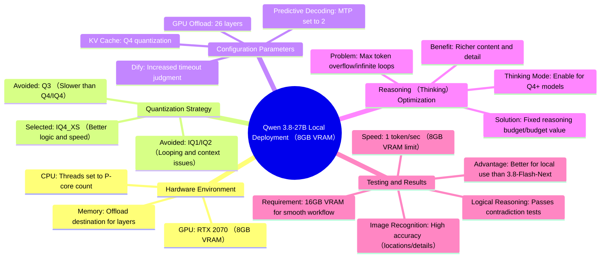

# Qwen-27B 8GB VRAM 本地部署优化

### 播放源

<iframe class="nlm-video" src="https://www.youtube.com/embed/txUByfiaeOM" title="Qwen-27B 8GB VRAM 本地部署优化" frameborder="0" allowfullscreen allow="accelerometer; autoplay; clipboard-write; encrypted-media; picture-in-picture"></iframe>

[在 YouTube 打开](https://www.youtube.com/watch?v=txUByfiaeOM)

## 产物

### 思维导图

### 信息图

点图看原图

### 演示文稿

<iframe src="https://pdf.hfhfn.dpdns.org/notebooklm/Qwen-27B%208GB%20VRAM%20%E6%9C%AC%E5%9C%B0%E9%83%A8%E7%BD%B2%E4%BC%98%E5%8C%96/slide-deck.pdf#view=FitH" class="nlm-slides" title="演示文稿" loading="lazy"></iframe>

[全屏打开](https://pdf.hfhfn.dpdns.org/notebooklm/Qwen-27B%208GB%20VRAM%20%E6%9C%AC%E5%9C%B0%E9%83%A8%E7%BD%B2%E4%BC%98%E5%8C%96/slide-deck.pdf)

## 摘要

提供的逐字稿展示了如何在配备 8GB VRAM 显卡的普通计算机上本地部署先进的 Qwen 
3.8-27B 模型。由于高精度量化版本超出了有限的显存容量，演示者采用了 IQ4 
量化设置，并结合了策略性的硬件管理，例如将层卸载至 GPU 以及压缩 context 
caches。通过包含逻辑谜题、图像识别和创意场景生成的各项测试，视频突出了在正确配
置 thinking mode 
时该模型令人印象深刻的推理能力。最终，虽然在低端硬件上运行此配置对于日常任务来
说非常缓慢，但该演示证明了只要参数配置正确，本地部署是完全可行的。
