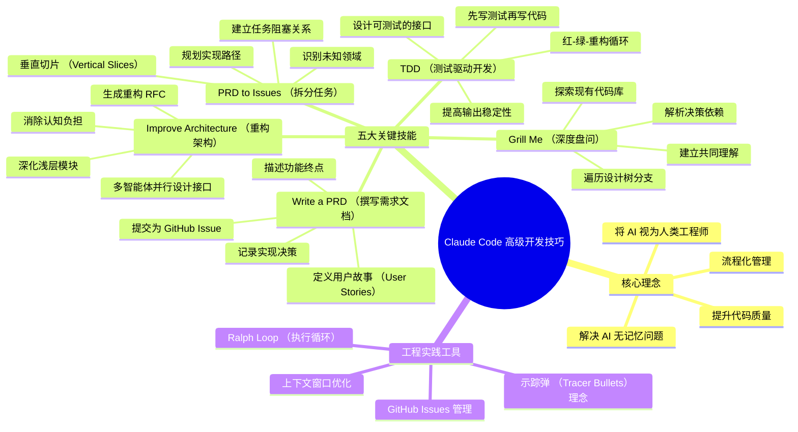
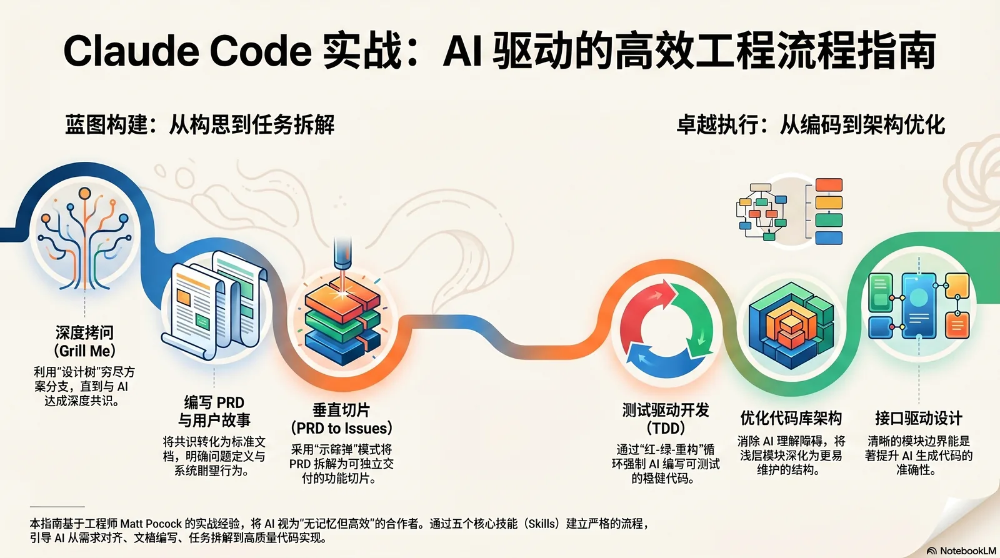

# mattpocock/skills仓库的AI-Coding工程流程Skills

### 播放源

<iframe class="nlm-video" src="https://www.youtube.com/embed/EJyuu6zlQCg" title="mattpocock/skills仓库的AI-Coding工程流程Skills" frameborder="0" allowfullscreen allow="accelerometer; autoplay; clipboard-write; encrypted-media; picture-in-picture"></iframe>

[在 YouTube 打开](https://www.youtube.com/watch?v=EJyuu6zlQCg)

## 产物

### 思维导图

### 信息图

点图看原图

## 摘要

由于 AI coding agents 缺乏记忆，开发者必须建立严格的工作流程和自定义 
skills，以成功引导其自动化工具并提升整体代码质量。为了实现这一目标，工程师依赖
于特定的技术，例如使用 grill me skill 
进行深入的规划对话，创建详细的产品需求文档（PRD），并将该目标规划拆解为易于管理
的 GitHub issues。此外，实施测试驱动开发（TDD）能够强制 agent 遵循可靠的 
red-green-refactor 循环，从而大幅提升实现的可靠性。最后，利用 architecture 
improvement skill 有助于将混乱的项目重构为结构良好的模块，这最终使 AI 
能够生成更整洁、更可维护的代码。
