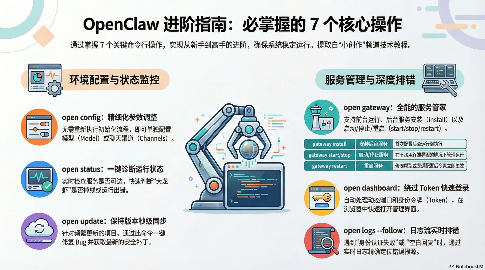

# openclaw常用操作指令

> 由 NotebookLM 笔记本导出的产物集合。

## 产物

### 思维导图

OpenClaw (OpenCloud) 基本操作指南
<ul class="mm-list mm-top"><li>

初始化与重置
<ul class="mm-list"><li>

opencloud init
<ul class="mm-list"><li class="mm-leaf">重新走一遍初始设置流程</li></ul>
</li></ul>
</li><li>

配置管理 (config)
<ul class="mm-list"><li>

opencloud config
<ul class="mm-list"><li class="mm-leaf">model: 独立设置模型</li><li class="mm-leaf">channels: 配置聊天渠道</li></ul>
</li></ul>
</li><li>

运行状态检查
<ul class="mm-list"><li>

opencloud status
<ul class="mm-list"><li class="mm-leaf">查看运行状态与错误信息</li></ul>
</li></ul>
</li><li>

Gateway 服务控制
<ul class="mm-list"><li class="mm-leaf">前台运行: opencloud gateway</li><li class="mm-leaf">后台服务安装: opencloud gateway install</li><li class="mm-leaf">后台启动: opencloud gateway start</li><li class="mm-leaf">停止服务: opencloud gateway stop</li><li class="mm-leaf">重启服务: opencloud gateway restart</li></ul>
</li><li>

快捷访问
<ul class="mm-list"><li>

opencloud dashboard
<ul class="mm-list"><li class="mm-leaf">自动带Token打开Web界面</li></ul>
</li></ul>
</li><li>

故障排查
<ul class="mm-list"><li>

opencloud logs --follow
<ul class="mm-list"><li class="mm-leaf">实时查看运行日志</li><li class="mm-leaf">排查API Key或认证错误</li></ul>
</li></ul>
</li><li>

系统更新
<ul class="mm-list"><li>

opencloud update
<ul class="mm-list"><li class="mm-leaf">修复Bug与提升安全性</li></ul>
</li></ul>
</li></ul>

### 信息图

点图看原图

## 摘要

（在 NotebookLM 里点「摘要」复制正文粘到这里）
