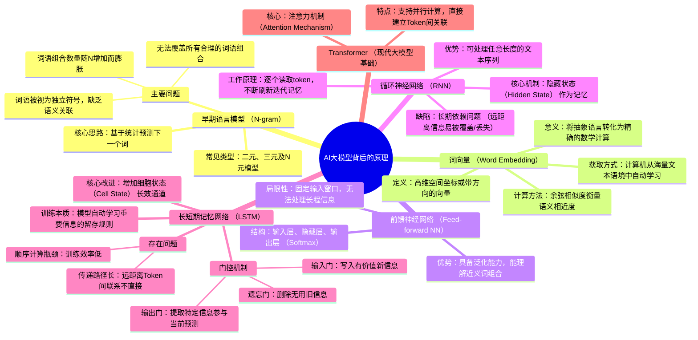

# 从向量到transformer, 大模型演进历程

### 播放源

<iframe class="nlm-video" src="https://www.youtube.com/embed/j-PLWhTJVsc" title="从向量到transformer, 大模型演进历程" frameborder="0" allowfullscreen allow="accelerometer; autoplay; clipboard-write; encrypted-media; picture-in-picture"></iframe>

[在 YouTube 打开](https://www.youtube.com/watch?v=j-PLWhTJVsc)

## 产物

### 思维导图

### 信息图

点图看原图

### 演示文稿

<iframe src="https://pdf.hfhfn.dpdns.org/notebooklm/%E4%BB%8E%E5%90%91%E9%87%8F%E5%88%B0transformer%2C%20%E5%A4%A7%E6%A8%A1%E5%9E%8B%E6%BC%94%E8%BF%9B%E5%8E%86%E7%A8%8B/slide-deck.pdf#view=FitH" class="nlm-slides" title="演示文稿" loading="lazy"></iframe>

[全屏打开](https://pdf.hfhfn.dpdns.org/notebooklm/%E4%BB%8E%E5%90%91%E9%87%8F%E5%88%B0transformer%2C%20%E5%A4%A7%E6%A8%A1%E5%9E%8B%E6%BC%94%E8%BF%9B%E5%8E%86%E7%A8%8B/slide-deck.pdf)

## 摘要

提供的逐字稿详细记录了用于预测文本的自然语言处理架构的时序演进历程。早期的统计
语言模型完全依赖于词语组合的计数，这限制了它们理解新短语或语义相似性的能力。为
了克服这一限制，研究人员开发了词向量，将词语表示为高维空间中的坐标，使模型能够
衡量语义关系。前馈神经网络利用这些向量来学习复杂的语言模式，尽管它们仍受到固定
输入窗口的限制。循环神经网络的引入允许模型通过维护隐藏状态来处理任意长度的序列
，但它们在处理长距离记忆依赖方面依然困难。这一局限性促成了长短期记忆网络的产生
，它融入了专门的门控机制和细胞状态，以便在更长的上下文中选择性地保留或丢弃信息
。最终，尽管这些技术进步逐步提升了文本理解能力，但顺序处理的瓶颈为 Transformer 
架构的发展铺平了道路。
