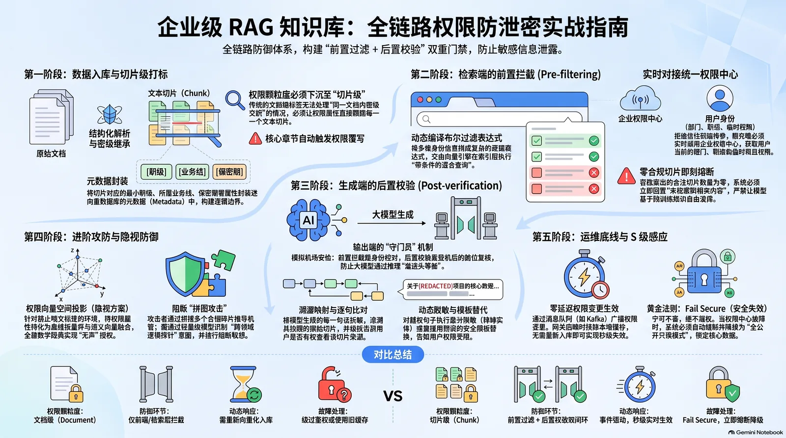

# 企业RAG安全：全链接权限和防泄漏策略

> 由 NotebookLM 笔记本导出的产物集合。

## 产物

- **思维导图**：`_assets/企业RAG安全：全链接权限和防泄漏策略/mind-map.json`
- **信息图**：

  
- **演示文稿**：[下载 PDF](https://pdf.hfhfn.dpdns.org/notebooklm/%E4%BC%81%E4%B8%9ARAG%E5%AE%89%E5%85%A8%EF%BC%9A%E5%85%A8%E9%93%BE%E6%8E%A5%E6%9D%83%E9%99%90%E5%92%8C%E9%98%B2%E6%B3%84%E6%BC%8F%E7%AD%96%E7%95%A5/slide-deck.pdf)

## 摘要

（在 NotebookLM 里点「摘要」复制正文粘到这里）
