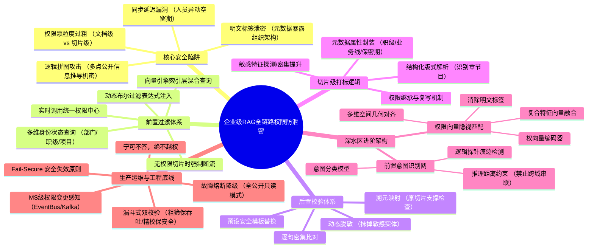

# 企业RAG安全：全链接权限和防泄漏策略

### 播放源

<iframe class="nlm-video" src="https://www.youtube.com/embed/aGpyWKtgjoU" title="企业RAG安全：全链接权限和防泄漏策略" frameborder="0" allowfullscreen allow="accelerometer; autoplay; clipboard-write; encrypted-media; picture-in-picture"></iframe>

[在 YouTube 打开](https://www.youtube.com/watch?v=aGpyWKtgjoU)

## 产物

### 思维导图

### 信息图

点图看原图

### 演示文稿

<iframe src="https://pdf.hfhfn.dpdns.org/notebooklm/%E4%BC%81%E4%B8%9ARAG%E5%AE%89%E5%85%A8%EF%BC%9A%E5%85%A8%E9%93%BE%E6%8E%A5%E6%9D%83%E9%99%90%E5%92%8C%E9%98%B2%E6%B3%84%E6%BC%8F%E7%AD%96%E7%95%A5/slide-deck.pdf#view=FitH" class="nlm-slides" title="演示文稿" loading="lazy"></iframe>

[全屏打开](https://pdf.hfhfn.dpdns.org/notebooklm/%E4%BC%81%E4%B8%9ARAG%E5%AE%89%E5%85%A8%EF%BC%9A%E5%85%A8%E9%93%BE%E6%8E%A5%E6%9D%83%E9%99%90%E5%92%8C%E9%98%B2%E6%B3%84%E6%BC%8F%E7%AD%96%E7%95%A5/slide-deck.pdf)

## 摘要

构建企业级 RAG 
知识库需要强大的安全架构，这远不止于基础的文档级打标，以防止数据泄漏。有效的系
统必须实现切片级权限粒度，确保访问控制直接嵌入到单个文本 chunk 
中，而不是一律统一对待整个文件。为了防御诸如 puzzle 
attacks（拼图攻击）这类复杂风险——即用户从多个公开片段中拼凑出敏感结论——部署结合
检索前过滤与生成后校验的双门防御机制至关重要。此外，在高度敏感的环境中，系统应
当采用先进的权限向量 embeddings，以消除明文 metadata 
漏洞。最终，保持严格的运维规程（例如在身份中心发生故障时立即进行 fail-secure 
熔断），能够确保生产环境中的安全与合规不受影响。
