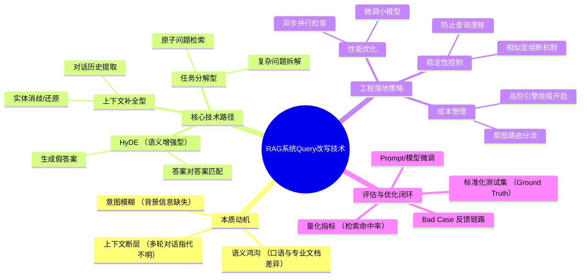

# 优化RAG检索：查询重写工程指南

### 播放源

<iframe class="nlm-video" src="https://www.youtube.com/embed/U3h2iTIYl5Q" title="优化RAG检索：查询重写工程指南" frameborder="0" allowfullscreen allow="accelerometer; autoplay; clipboard-write; encrypted-media; picture-in-picture"></iframe>

[在 YouTube 打开](https://www.youtube.com/watch?v=U3h2iTIYl5Q)

## 产物

### 思维导图

### 演示文稿

<iframe src="https://pdf.hfhfn.dpdns.org/notebooklm/%E4%BC%98%E5%8C%96RAG%E6%A3%80%E7%B4%A2%EF%BC%9A%E6%9F%A5%E8%AF%A2%E9%87%8D%E5%86%99%E5%B7%A5%E7%A8%8B%E6%8C%87%E5%8D%97/slide-deck.pdf#view=FitH" class="nlm-slides" title="演示文稿" loading="lazy"></iframe>

[全屏打开](https://pdf.hfhfn.dpdns.org/notebooklm/%E4%BC%98%E5%8C%96RAG%E6%A3%80%E7%B4%A2%EF%BC%9A%E6%9F%A5%E8%AF%A2%E9%87%8D%E5%86%99%E5%B7%A5%E7%A8%8B%E6%8C%87%E5%8D%97/slide-deck.pdf)

## 摘要

在现代 RAG 系统中，提升检索精度通常需要聚焦于查询重写，而不是简单地升级底层 
embedding 
模型或增加数据维度。未经适当转换时，口语化的用户表达、缺失的上下文背景以及模糊
的多轮代词会产生意图鸿沟，导致标准的向量空间难以精准匹配。为了弥合这一鸿沟，开
发者主要采用三大核心策略：假设驱动的查询增强（将问题与理想答案进行对齐）、任务
分解（将复杂查询拆解为更易处理的部分）以及上下文补全（解决模糊指代问题）。成功
的工程落地还要求克服实际挑战，例如通过并行处理降低延迟、利用基于相似度的熔断机
制防止语义漂移，以及通过部署意图路由控制 token 
费用。最终，通过基准数据集建立定量评估闭环，能够保障持续的性能跟踪，并将孤立的
组件转化为具备生产就绪能力的检索架构。
