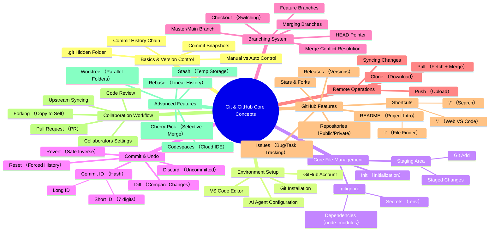

# 在AI时代掌握Git和GitHub

### 播放源

<iframe class="nlm-video" src="https://www.youtube.com/embed/bWUUHBVg-7E" title="在AI时代掌握Git和GitHub" frameborder="0" allowfullscreen allow="accelerometer; autoplay; clipboard-write; encrypted-media; picture-in-picture"></iframe>

[在 YouTube 打开](https://www.youtube.com/watch?v=bWUUHBVg-7E&t=20s)

## 产物

### 思维导图

### 演示文稿

<iframe src="https://pdf.hfhfn.dpdns.org/notebooklm/%E5%9C%A8AI%E6%97%B6%E4%BB%A3%E6%8E%8C%E6%8F%A1Git%E5%92%8CGitHub/slide-deck.pdf#view=FitH" class="nlm-slides" title="演示文稿" loading="lazy"></iframe>

[全屏打开](https://pdf.hfhfn.dpdns.org/notebooklm/%E5%9C%A8AI%E6%97%B6%E4%BB%A3%E6%8E%8C%E6%8F%A1Git%E5%92%8CGitHub/slide-deck.pdf)

## 摘要

本视频教程讲解了如何在 AI 时代高效使用 Git 和 
GitHub，强调用户无需死记硬背复杂的命令，因为可以通过自然语言利用 
AI。它概述了本地仓库、commit、branch 和 working tree 
等核心版本控制概念，以便安全地追踪变更并管理项目历史。演示者展示了如何初始化项
目、处理合并冲突，以及使用 discard、reset 和 revert 
等撤销操作来纠正错误。此外，内容还涵盖了远程仓库同步、cloning 
以及用于开源协作贡献的 pull request。最后，探讨了 stashing、cherry-picking 和 
rebasing 等高级操作，以帮助开发者保持清晰高效的版本控制工作流。
