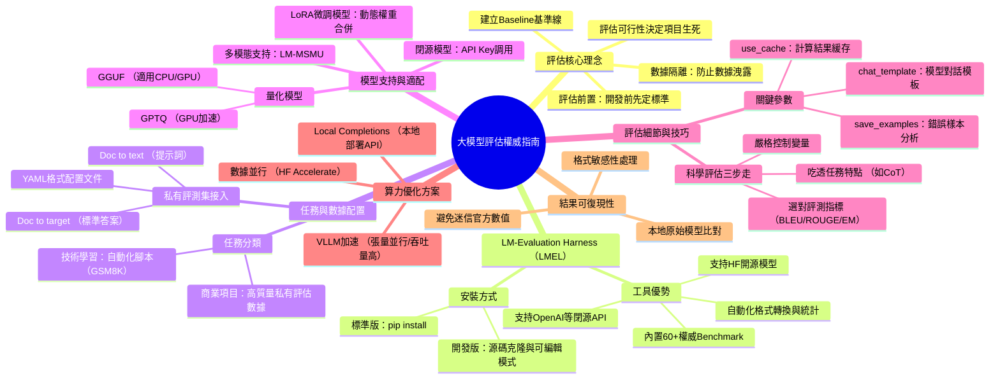

# 大模型评估 lm-eval 实用指南

### 播放源

<iframe class="nlm-video" src="https://www.youtube.com/embed/17lpoQA6Wno" title="大模型评估 lm-eval 实用指南" frameborder="0" allowfullscreen allow="accelerometer; autoplay; clipboard-write; encrypted-media; picture-in-picture"></iframe>

[在 YouTube 打开](https://www.youtube.com/watch?v=17lpoQA6Wno)

## 产物

### 思维导图

### 演示文稿

<iframe src="https://pdf.hfhfn.dpdns.org/notebooklm/%E5%A4%A7%E6%A8%A1%E5%9E%8B%E8%AF%84%E4%BC%B0%20lm-eval%20%E5%AE%9E%E7%94%A8%E6%8C%87%E5%8D%97/slide-deck.pdf#view=FitH" class="nlm-slides" title="演示文稿" loading="lazy"></iframe>

[全屏打开](https://pdf.hfhfn.dpdns.org/notebooklm/%E5%A4%A7%E6%A8%A1%E5%9E%8B%E8%AF%84%E4%BC%B0%20lm-eval%20%E5%AE%9E%E7%94%A8%E6%8C%87%E5%8D%97/slide-deck.pdf)

## 摘要

高效的大语言模型评估对于任何微调项目的成功都至关重要，因为它能确保模型在部署前
得到可靠测试，而不是依赖凭空猜测。提前优先考虑评估有助于避免资源浪费，并建立针
对特定业务目标或学习任务的明确性能指标。行业标准框架 lm-evaluation harness 
通过支持广泛的开源模型、量化版本以及像 OpenAI 这样基于 API 
的系统，简化了这一流程。从业人员可以无缝测试自定义配置、整合私有数据集，并利用
先进的硬件配置来优化测试效率。最终，保持一致的测试环境以及仔细分析单个样本输出
，是准确衡量模型改进并避免常见坑点的必备实践。
