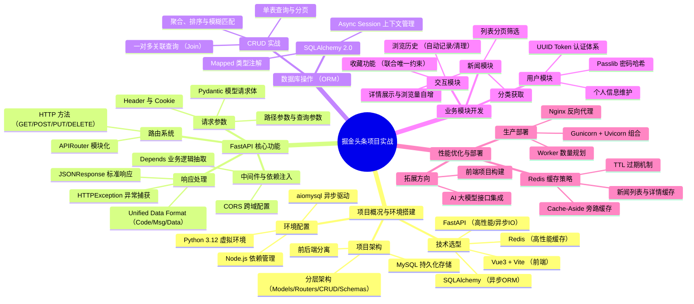

# 掘金头条项目实战抽取面试知识点

## 产物

### 思维导图

## 摘要

这些材料概述了一套基于 FastAPI 和 Vue3 
构建现代解耦新闻资讯平台的完整课程体系。课程从项目初始化与 FastAPI 
基础知识开始，详细讲解路由、参数校验及中间件配置。随后，学员将深入学习通过 
SQLAlchemy 进行数据库集成，实现健壮的 CRUD 
操作与异步管理。核心应用功能得到系统化开发，涵盖新闻分类、用户认证以及书签和阅
读历史等互动模块。通过采用 Cache-Aside 模式的 Redis 
缓存策略进一步提升性能，以应对高并发场景。最后，课程以使用 Gunicorn、Uvicorn 
以及 Nginx 反向代理的生产部署流程结束。
