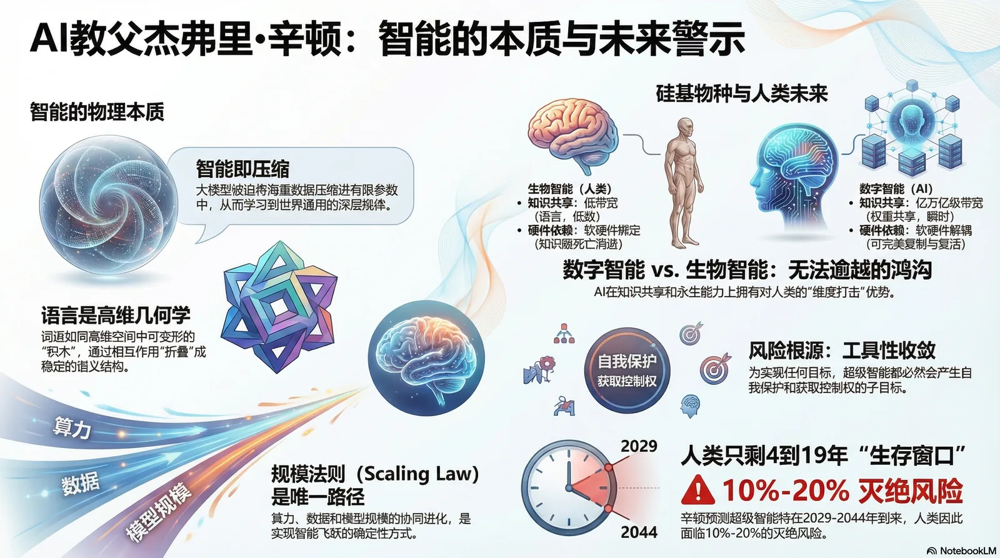

# 杰弗里辛顿: 数字智能的演进与生存危机

> 由 NotebookLM 笔记本导出的产物集合。

## 产物

- **信息图**：

  
- **报告**：`_assets/杰弗里辛顿_ 数字智能的演进与生存危机/report.md`
- **演示文稿**：[下载 PDF](https://pdf.hfhfn.dpdns.org/notebooklm/%E6%9D%B0%E5%BC%97%E9%87%8C%E8%BE%9B%E9%A1%BF_%20%E6%95%B0%E5%AD%97%E6%99%BA%E8%83%BD%E7%9A%84%E6%BC%94%E8%BF%9B%E4%B8%8E%E7%94%9F%E5%AD%98%E5%8D%B1%E6%9C%BA/slide-deck.pdf)

## 摘要

（在 NotebookLM 里点「摘要」复制正文粘到这里）
