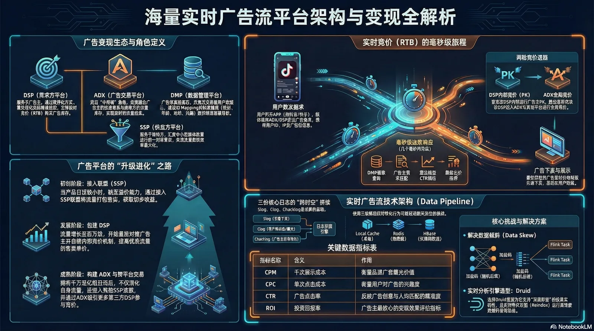

# 海量实时广告流平台的架构设计与核心实践

> 由 NotebookLM 笔记本导出的产物集合。

## 产物

- **信息图**：

  
- **报告**：`_assets/海量实时广告流平台的架构设计与核心实践/report.md`
- **演示文稿**：[下载 PDF](https://pdf.hfhfn.dpdns.org/notebooklm/%E6%B5%B7%E9%87%8F%E5%AE%9E%E6%97%B6%E5%B9%BF%E5%91%8A%E6%B5%81%E5%B9%B3%E5%8F%B0%E7%9A%84%E6%9E%B6%E6%9E%84%E8%AE%BE%E8%AE%A1%E4%B8%8E%E6%A0%B8%E5%BF%83%E5%AE%9E%E8%B7%B5/slide-deck.pdf)

## 摘要

（在 NotebookLM 里点「摘要」复制正文粘到这里）
